# 📖 Professor Vacuumus: Anleitung fürs Standpersonal

**Deutsch** · [English](GUIDE.en.md)

Diese Anleitung erklärt Schritt für Schritt, wie das Messespiel am Stand läuft: starten, Besucher anmelden, spielen lassen, Gewinner finden und am Abend die Kontakte sichern. Technisches Wissen braucht es dafür nicht.

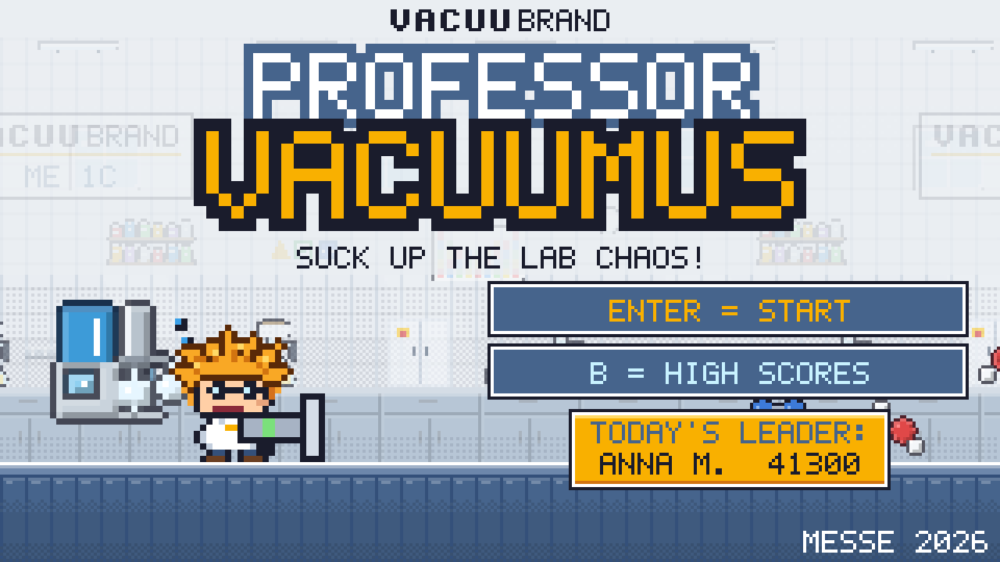

## Inhalt

1. [Das Wichtigste auf einen Blick](#1-das-wichtigste-auf-einen-blick)
2. [Herunterladen und installieren](#2-herunterladen-und-installieren)
3. [Spiel starten (Laptop)](#3-spiel-starten-laptop)
4. [Tablet am Stand](#4-tablet-am-stand)
5. [Ablauf am Stand, Schritt für Schritt](#5-ablauf-am-stand-schritt-für-schritt)
6. [Steuerung](#6-steuerung)
7. [Das Spiel erklärt (für Fragen der Besucher)](#7-das-spiel-erklärt-für-fragen-der-besucher)
8. [Schnellstart ohne Anmeldung](#8-schnellstart-ohne-anmeldung)
9. [Admin-Bereich](#9-admin-bereich)
10. [Sprachen und Länder](#10-sprachen-und-länder)
11. [QR-Codes prüfen](#11-qr-codes-prüfen)
12. [Datenschutz](#12-datenschutz)
13. [Anpassen](#13-anpassen)
14. [Hilfe bei Problemen](#14-hilfe-bei-problemen)

---

## 1. Das Wichtigste auf einen Blick

| Wann | Was tun |
|---|---|
| **Vor der Messe** | Spiel einmal durchspielen, Admin-PIN ändern, Messename und Preise eintragen, Referenzdaten löschen |
| **Jeden Morgen** | Start-Datei doppelklicken, Ton prüfen, Controller einstecken |
| **Während der Messe** | Besucher ansprechen, Land wählen lassen, beim Anmelden helfen, nach der Runde den QR-Code zeigen |
| **Jeden Abend** | Im Admin-Bereich **Leads (CSV/Excel)** exportieren und auf einen USB-Stick kopieren |
| **Nach der Messe** | Letzter Export, dann im Admin-Bereich **Alle Daten löschen** |

> [!TIP]
> Eine Runde dauert **2 Minuten**. Ein Game Over gibt es nicht: Treffer kosten nur Zeit. So hat jeder Besucher ein Erfolgserlebnis.

> [!WARNING]
> Die Daten liegen nur im Browser dieses Geräts. Wer den Browserverlauf oder die Cookies löscht, löscht auch die Bestenliste und die Kontakte. Deshalb jeden Abend exportieren.

---

## 2. Herunterladen und installieren

Die fertige Download-Version liegt auf GitHub: **[Neueste Version herunterladen](https://github.com/GSB-Deleven/vacuubrand-game/releases/latest)**.
Dort unten bei „Assets“ die Datei `Professor-Vacuumus-v….zip` laden (nicht „Source code“).

| System | So geht's |
|---|---|
| 🪟 Windows | ZIP rechtsklicken → **Alle extrahieren**. Nicht direkt im ZIP starten. Im Ordner `Professor-Vacuumus` die Datei `▶ START Windows.bat` doppelklicken. Fragt Windows „Der Computer wurde geschützt“: **Weitere Informationen** → **Trotzdem ausführen** |
| 🍎 Mac | ZIP doppelklicken (entpackt automatisch). `▶ START Mac.command` beim ersten Mal mit Rechtsklick → **Öffnen** → Öffnen starten. Kommt „keine Berechtigung“: im Terminal `chmod +x ` eintippen, die Datei ins Fenster ziehen, Enter |
| 🍓 Raspberry Pi / Linux | ZIP entpacken (Rechtsklick → Hier entpacken, oder im Terminal `unzip Professor-Vacuumus-v….zip`). `▶ START Linux + Raspberry Pi.sh` doppelklicken. Startet es nicht: im Ordner im Terminal `chmod +x *.sh raspberry-pi/*.sh`. Automatischer Start beim Einschalten: [raspberry-pi/README.md](raspberry-pi/README.md) |

Welche Version läuft, steht klein oben im Admin-Bereich (z. B. „Version 0.9.0“).

> [!IMPORTANT]
> **Bei einer neuen Version:** Bestenliste vorher im Admin sichern (JSON), neuen Ordner an **dieselbe Stelle** legen (alten ersetzen), sonst sieht das Spiel die bisherige Bestenliste nicht. Notfalls die Sicherung im Admin wieder laden.

---

## 3. Spiel starten (Laptop)

Das Spiel braucht keine Installation und kein Internet.

1. Den entpackten Ordner (oder den ganzen Spielordner) auf den Messe-Laptop kopieren (z. B. auf den Desktop).
2. Die passende Start-Datei doppelklicken:

| System | Start-Datei (Doppelklick) |
|---|---|
| 🪟 Windows | `▶ START Windows.bat` (Edge im Vollbild) |
| 🍎 Mac | `▶ START Mac.command` (Chrome/Edge im Vollbild, sonst Safari). Beim ersten Mal: Rechtsklick → **Öffnen** → Öffnen |
| 🐧 Linux / 🍓 Raspberry Pi | `▶ START Linux + Raspberry Pi.sh` (Chromium im Vollbild). Automatisch beim Einschalten: siehe [raspberry-pi/README.md](raspberry-pi/README.md) |
| alle | Notfalls einfach `index.html` doppelklicken |

3. Beenden: **Alt + F4** (Mac: **Cmd + Q**).

Läuft in Edge, Chrome und Firefox.

> [!IMPORTANT]
> **Immer denselben Browser und denselben Ordner benutzen.** Sonst sieht das Spiel die bisherige Bestenliste nicht.

---

## 4. Tablet am Stand

1. Auf dem Tablet im Browser **https://gsb-deleven.github.io/vacuubrand-game/?messe** öffnen.
2. Einmal **„Zum Home-Bildschirm“** hinzufügen (iPad: Teilen-Symbol → „Zum Home-Bildschirm“; Android: Menü ⋮ → „App installieren“). Dann startet es wie eine App im Vollbild und läuft auch ohne WLAN.
3. Tablet quer halten. Beim ersten Antippen erscheinen die Bildschirm-Tasten.
4. **Admin-Bereich:** 3 Sekunden auf das VACUUBRAND-Logo oben drücken, dann PIN.
5. Die Daten liegen nur auf diesem Tablet. Exportieren wie am Laptop über den Admin-Bereich („Inhalt kopieren“ funktioniert auch, wenn der Download nicht klappt).

> [!WARNING]
> Wichtig ist **`?messe`** am Ende des Links. Ohne diesen Zusatz startet die Online-Demo: Dort gibt es nur einen Spitznamen, keine Kontaktdaten und keinen Admin-Bereich.

<table>
<tr>
<td width="60%">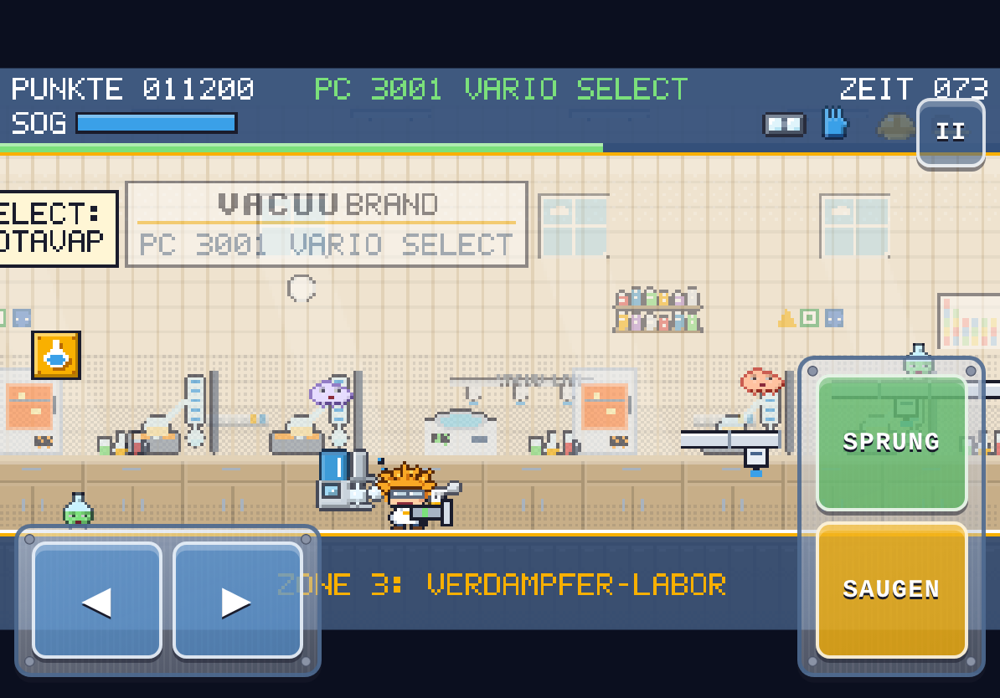 Auf dem Tablet: links ◀ ▶ zum Laufen, rechts SPRUNG und SAUGEN, oben rechts Pause.</td>
<td width="40%">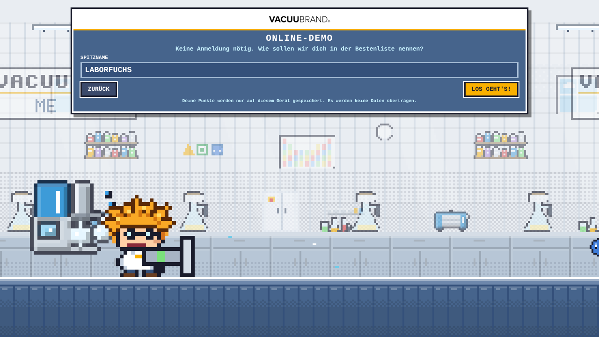 So sieht die Online-Demo aus (ohne <code>?messe</code>): nur ein Spitzname.</td>
</tr>
</table>

---

## 5. Ablauf am Stand, Schritt für Schritt

### Schritt 1: Titelbild

Auf dem Titelbild läuft eine Demo, die Besucher anlockt. **Enter** (oder Klick auf den Knopf) startet, **B** zeigt die Bestenliste.

Das Titelbild ist **immer auf Englisch** (z. B. „B = HIGH SCORES“), damit es an jeder Messe passt. Ab der Länderwahl gilt die Sprache des Spielers.

### Schritt 2: Land und Sprache wählen

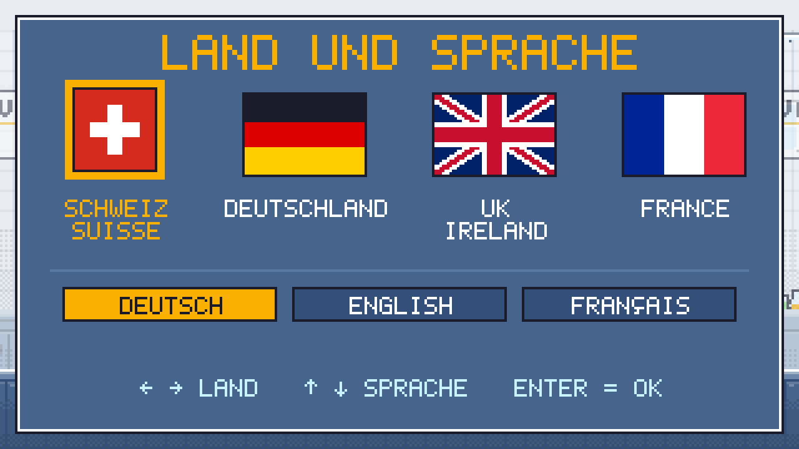

Vier Flaggen (Schweiz, Deutschland, UK/Irland, Frankreich), darunter die Zeile SPRACHE: DEUTSCH · ENGLISH · FRANÇAIS und ganz unten der grosse Knopf **START**.

1. **Flagge wählen:** Das markiert nur das Land und stellt gleich die passende Sprache ein (Schweiz und Deutschland: Deutsch, UK: Englisch, Frankreich: Französisch). Es startet noch nicht.
2. **Sprache ändern (nur wenn nötig):** z. B. ein Gast aus der Westschweiz wählt die Schweizer Flagge und dann FRANÇAIS. Wer danach nochmals eine Flagge wählt, bekommt wieder deren Sprache.
3. **START** drücken: Jetzt geht es zur Anmeldung in der gewählten Sprache.

- **Tastatur/Gamepad:** ↑ ↓ wechselt zwischen den drei Zeilen (Flaggen, Sprache, START), ← → wählt in der Zeile, Enter startet von überall.
- **Tablet/Handy:** Flagge antippen, falls nötig Sprache antippen, dann START antippen.
- Nach 60 Sekunden ohne Eingabe geht es zurück zum Titelbild.

### Schritt 3: Anmelden

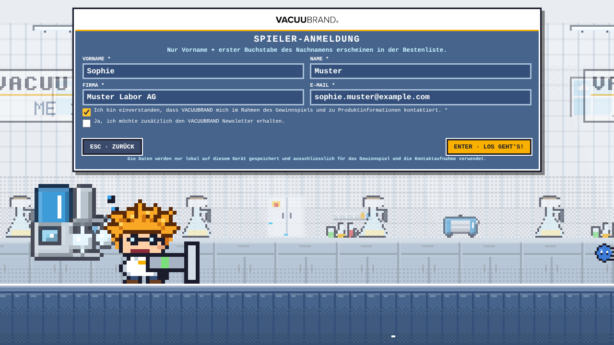

Vorname, Name, Firma, E-Mail und die Einwilligung sind Pflicht, der Newsletter ist freiwillig. Das Formular erscheint in der gewählten Sprache. Die Anmeldung geht nur mit Tastatur (oder auf dem Tablet mit der Bildschirm-Tastatur).

> [!TIP]
> Am besten tippt das Standpersonal die Daten ein, während der Besucher erzählt. Das geht schneller und ergibt gleich einen Gesprächseinstieg.

### Schritt 4: Kurze Anleitung, dann spielen

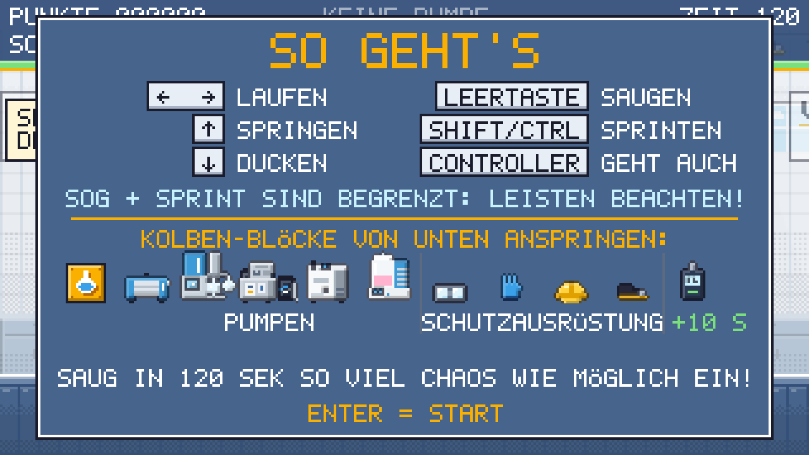

Die Anleitung zeigt Tasten, Pumpen und Schutzausrüstung. Mit **Enter** geht es weiter, dann zählt das Spiel 3, 2, 1 herunter und die Runde läuft.

### Schritt 5: Ergebnis mit Medaillen

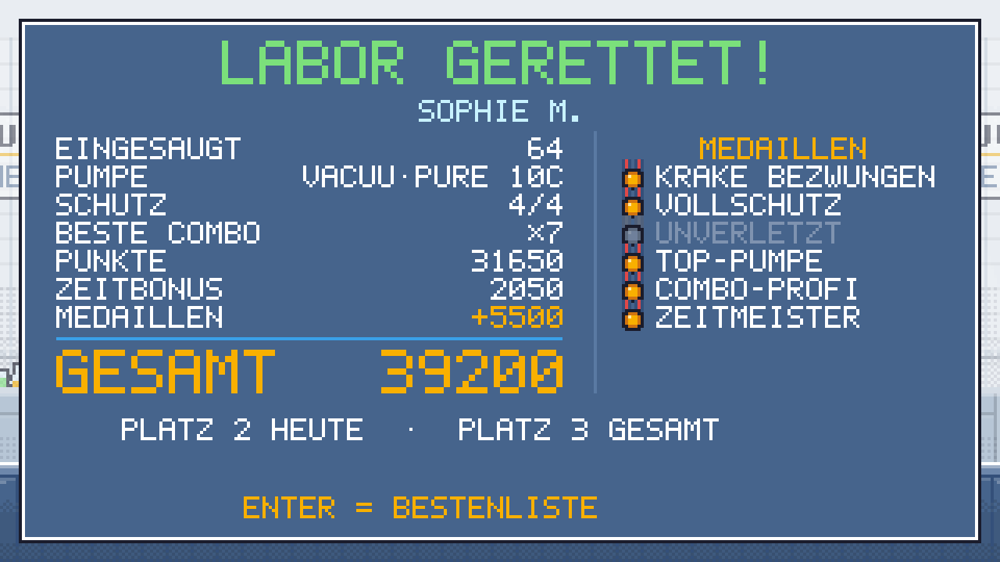

Punkte, Zeitbonus, Medaillen und die Platzierung von heute und von der ganzen Messe.

### Schritt 6: Kontakt-Seite mit QR-Code

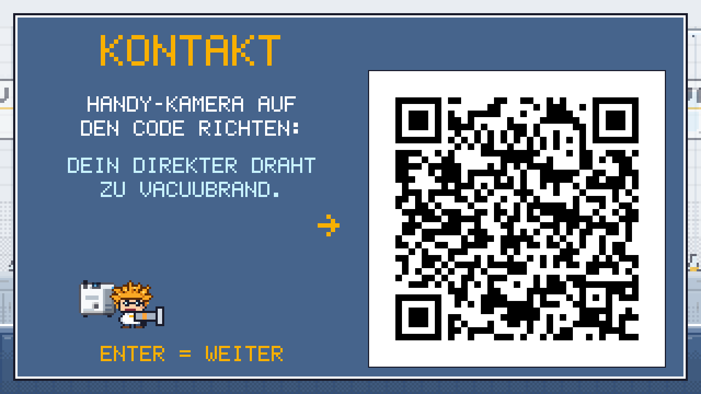

Ein grosser QR-Code führt zu den Ansprechpartnern des gewählten Landes. Die Seite bleibt stehen, bis jemand Enter drückt, tippt oder einen Knopf drückt. So hat der Besucher Zeit zum Scannen.

### Schritt 7: Bestenliste

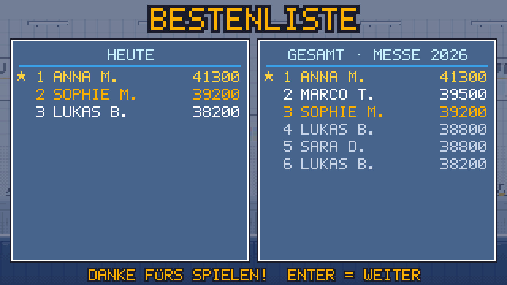

In der öffentlichen Bestenliste erscheint nur **„Vorname N.“**. Wer mehrmals spielt (gleiche E-Mail), steht mit seinem besten Ergebnis drin. Nach 20 Sekunden geht es zurück zum Titelbild.

---

## 6. Steuerung

### Tastatur

| Taste | Aktion |
|---|---|
| ← → | laufen |
| ↑ | springen |
| ↓ | ducken |
| Leertaste (halten) | saugen: die **SOG**-Leiste leert sich, danach kurz abkühlen lassen |
| Shift oder Ctrl (halten) | sprinten: **SPRINT**-Leiste beachten |
| Enter | Start / bestätigen |
| Esc | Pause / zurück |
| M | Ton an/aus |
| F | Vollbild (auf dem Titelbild) |
| B | Bestenliste ein/aus (auf dem Titelbild) |

### Gamepad und Joystick

Xbox-/USB-Gamepads und einfache USB-Joysticks einfach einstecken, sie werden automatisch erkannt („CONTROLLER VERBUNDEN“; evtl. einmal eine Taste drücken). Die Tastatur funktioniert weiterhin.

| Gamepad (Xbox-Layout) | Joystick | Aktion |
|---|---|---|
| Stick / Steuerkreuz | Stick | laufen, ↑ springen, ↓ ducken |
| A oder Y | Knopf 2 / 3 | springen |
| B oder X | Feuerknopf | saugen |
| LB / RB / LT / RT | weitere Knöpfe | sprinten |
| Start / A | Feuerknopf | Start / weiter |
| Start oder Back | Knopf 9 / 10 | Pause ein/aus |

> [!TIP]
> **Knöpfe liegen falsch?** (z. B. Arcade-Joystick) Im Admin-Bereich unter **Controller / Joystick → Controller einrichten** der Reihe nach Springen, Saugen, Sprinten und Start drücken. Das Spiel merkt sich die Belegung für dieses Controller-Modell.

### Touch (Tablet und Handy)

| Bildschirm-Taste | Aktion |
|---|---|
| ◀ ▶ (links) | laufen |
| SPRUNG (rechts oben) | springen |
| SAUGEN (rechts unten) | saugen |
| beide zugleich | auf die Naht zwischen SPRUNG und SAUGEN drücken |
| II (oben rechts) | Pause |
| Antippen | Start / weiter |

Sprinten und Ducken gibt es auf Touch nicht.

### Gut zu wissen

- Eine Runde abbrechen geht nur mit **Esc → Enter** auf der Tastatur, damit Spieler nicht aus Versehen abbrechen.
- Wenn jemand 5× Shift drückt, fragt Windows nach der „Einrastfunktion“. Abschalten unter *Einstellungen → Barrierefreiheit → Tastatur → Einrastfunktion* (Tastenkombination deaktivieren). Sprinten geht auch mit Ctrl.

---

## 7. Das Spiel erklärt (für Fragen der Besucher)

Der verrückte Professor (oranges Wuschelhaar, runde Brille, wie unser Maskottchen) saugt mit seiner Saugpistole das Labor-Chaos weg. Aus den **Kolben-Blöcken** holt er sich immer stärkere Pumpen, Schutzausrüstung und Spezial-Geräte. Die Level zeigen die echten Anwendungen der Pumpen.

### Die fünf Labore

| Zone | Gerät | Anwendungen / Gegner |
|---|---|---|
| 1 Filtrationslabor | **ME 1C** | Filtration: Filtrat-Tropfen, Partikel, Filterpapier, Reagenzgläser, H₂O |
| 2 Zellkultur-Labor | **BVC professional** (Spezial) | Medienabsaugung: Nährmedium, Petrischalen-Schleim, Wellplatten, H₂O₂ |
| 3 Verdampfer-Labor | **PC 3001 VARIO select** | Rotavap, Vakuum-Konzentrator, Trockenschrank: Lösemitteldampf, Hitzedampf, Rundkolben, Messbecher, Eppis, Methanol, Ethanol |
| 4 Chemielabor | **MD 4C VARIO select** | Destillation und Trocknung: Säuredampf, Scheidetrichter, Lösemitteldampf, Methanol, Ethanol |
| 5 Hochvakuum-Technikum | **VACUU·PURE 10C** | Ölfreie Trocknung (Gefriertrocknung, Schlenk-Line, Turbo-Vorvakuum): Eiskristalle, O₂, N₂, H₂O, Schlenk-Kolben, Argon-Flaschen, **Dampf-Krake** (Boss) |

<table>
<tr>
<td width="33%">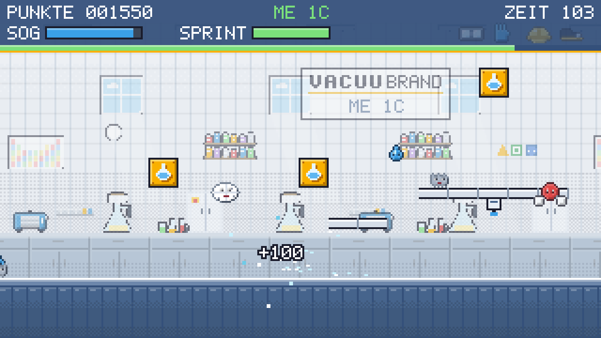 1 Filtrationslabor, <b>ME 1C</b></td>
<td width="33%">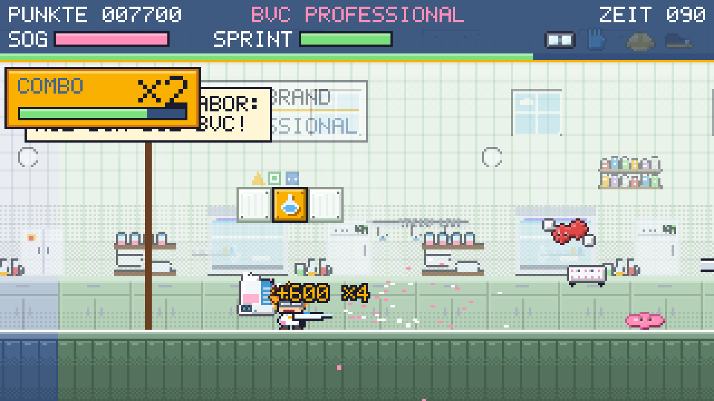 2 Zellkultur-Labor, <b>BVC professional</b></td>
<td width="33%">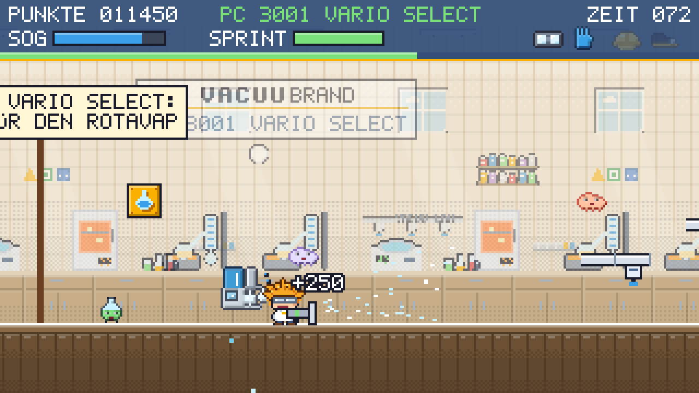 3 Verdampfer-Labor, <b>PC 3001 VARIO select</b></td>
</tr>
<tr>
<td>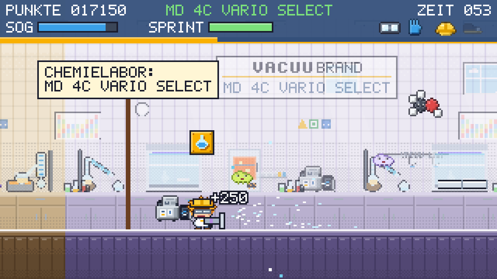 4 Chemielabor, <b>MD 4C VARIO select</b></td>
<td>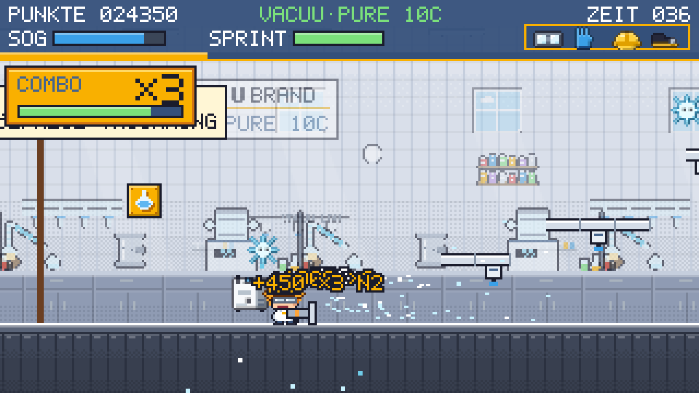 5 Hochvakuum-Technikum, <b>VACUU·PURE 10C</b></td>
<td>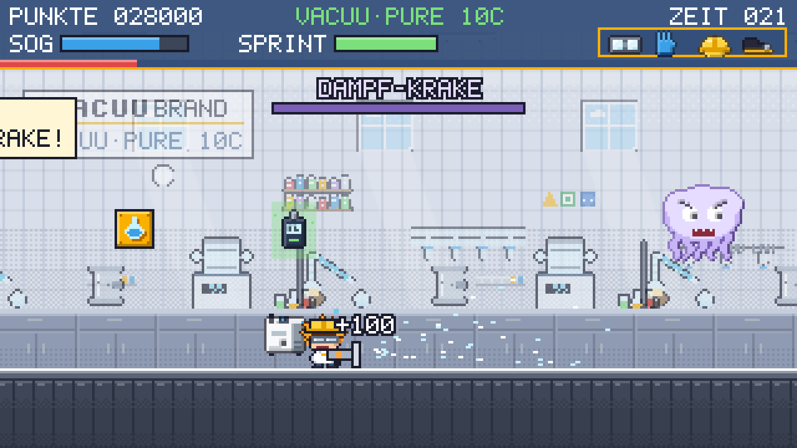 Endgegner <b>Dampf-Krake</b></td>
</tr>
</table>

Die durchspringbaren Plattformen sind **VACUU·LAN**-Leitungen.

### Items aus den Kolben-Blöcken

Die Items laufen wie die Pilze bei Mario davon: hinterher oder einfach einsaugen!

| Item | Wirkung |
|---|---|
| Pumpe ME 1C → PC 3001 VARIO select → MD 4C VARIO select → VACUU·PURE 10C | mehr Reichweite, schwerere Sachen einsaugen |
| Pumpe **BVC professional** (Zellkultur) | im ganzen Zellkultur-Labor: BVC auf dem Rücken, Pistole wird zum **VHC-Handstück**, saugt alles ein (Flüssigkeiten, Dämpfe und das ganze Labor-Chaos) ohne Energie-Limit mit doppelten Punkten; beim Verlassen des Labors wieder die normale Pumpe |
| Schutzbrille | Treffer kosten nur 1 statt 3 Sekunden |
| Handschuhe | Saug-Energie lädt doppelt so schnell |
| Schutzhelm | Gegner von unten wegköpfen |
| Sicherheitsschuhe | Gegner durch Draufspringen zerstören |
| alle 4 = **Vollschutz** | Gegner können nicht mehr schaden |
| VACUU·VIEW extended (versteckt, 3×) | „Zeitvakuum“: +10 Sekunden |

### Zeit, Combo und Medaillen

- **Zeit:** Eine Runde dauert **120 Sekunden**. Jedes neue Schutz-Teil gibt +2 Sekunden. Treffer kosten Zeit (kein Game Over). Die Zeit läuft zusätzlich als farbige **Zeitleiste** ab (grün → gelb → rot).
- **Ziel:** Wer die Dampf-Krake einsaugt und den Ausgang erreicht, bekommt die Restzeit als Bonus.
- **Combo:** Wer innerhalb von 2 Sekunden wieder etwas einsaugt, baut eine Serie auf: Punkte ×2, ×3 … bis **×8**. Der goldene Combo-Kasten oben links zeigt die Stufe und einen ablaufenden Timer. Ein Treffer beendet die Serie.
- **Musik:** Jede Zone hat ihre eigene Musik, die Dampf-Krake ein eigenes Boss-Thema.

**Medaillen** am Ende der Runde (Bonuspunkte zählen zum Gesamtergebnis):

| Medaille | Bedingung | Bonus |
|---|---|---|
| Krake bezwungen | Dampf-Krake eingesaugt | +2000 |
| Vollschutz | alle 4 Schutz-Teile | +1000 |
| Unverletzt | kein Treffer (mind. 10× eingesaugt) | +1500 |
| Top-Pumpe | VACUU·PURE 10C erreicht | +1000 |
| Combo-Profi | Combo ×5 oder höher | +1000 |
| Zeitmeister | alle 3 VACUU·VIEW gefunden | +500 |

---

## 8. Schnellstart ohne Anmeldung

Zum Testen oder Vorführen: Auf dem Titelbild, der Bestenliste oder im Anmeldeformular **Strg + Shift + Enter** drücken. Das Spiel startet sofort mit dem Spieler **ADMIN**.

> [!NOTE]
> Diese Testrunden werden **nicht** gespeichert und erscheinen weder in der Bestenliste noch im Export. Die Länderwahl wird übersprungen: Es gilt die Gerätesprache, der QR-Code am Ende zeigt die Ansprechpartner weltweit (alle Länder).

---

## 9. Admin-Bereich

Auf dem Titelbild **Strg + Shift + A** drücken (Tablet: 3 Sekunden aufs Logo), PIN eingeben.

> [!WARNING]
> Die Standard-PIN ist **1234**. Bitte vor der Messe ändern!

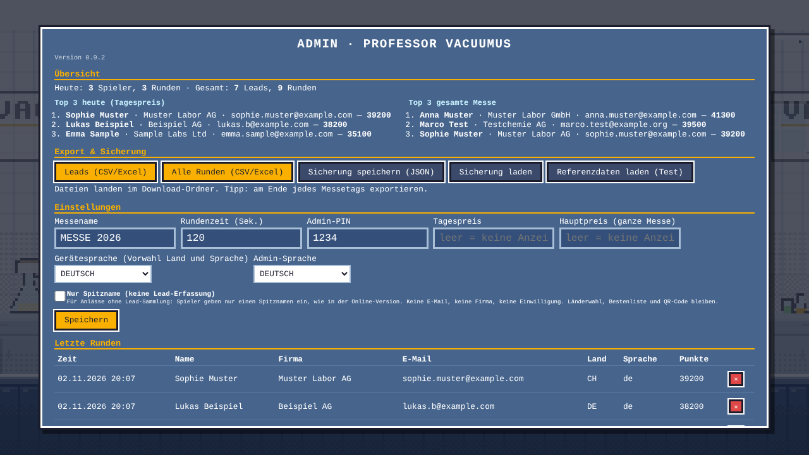

| Bereich | Was es kann |
|---|---|
| **Version** | steht klein unter der Überschrift (z. B. „Version 0.9.0“), damit man sieht, welche Version läuft |
| **Übersicht** | **Top 3 heute** (Tagespreis) und **Top 3 gesamte Messe** mit vollen Kontaktdaten |
| **Export & Sicherung** | **Leads (CSV/Excel)** und **Alle Runden (CSV/Excel)** exportieren, landen im Download-Ordner. **Sicherung speichern / laden** (JSON), z. B. um Daten auf einen anderen Laptop zu übertragen |
| **Einstellungen** | Messename, Rundenzeit, PIN, Tagespreis und Hauptpreis (Preise erscheinen auf Startbildschirm und Bestenliste) |
| **Gerätesprache** | bestimmt, welches Land und welche Sprache in der Länderwahl vorgewählt sind (Deutsch → Schweiz, Englisch → UK, Französisch → Frankreich). Auf einer Messe in Frankreich z. B. auf Französisch stellen. Das Titelbild bleibt immer Englisch (`titleLang` in `js/config.js`) |
| **Admin-Sprache** | Deutsch oder Englisch, z. B. für das Team in UK |
| **Controller / Joystick** | **Controller einrichten**, falls Knöpfe falsch liegen |
| **Letzte Runden** | einzelne Runden löschen (✕ zweimal klicken) |
| **Gefahrenzone** | **Alle Daten löschen** nach der Messe (LÖSCHEN ins Feld tippen) |

- Im Export stehen pro Runde und pro Lead zusätzlich **Land** (CH, DE, UK, FR) und **Sprache** (de, en, fr).
- **Referenzdaten laden (Test):** lädt Beispieldaten mit erfundenen Personen (Ordner `daten/`: JSON und CSV-Beispiele), um Bestenliste und Export auszuprobieren. Vor der Messe mit „Alle Daten löschen“ wieder entfernen.
- Nach jedem Export erscheint der Inhalt zusätzlich in einem Textfeld mit „Inhalt kopieren“. Praktisch, falls der Browser keinen Download erlaubt (z. B. in der Online-Vorschau).

> [!TIP]
> Am Ende jedes Messetags die Leads exportieren. Die Daten liegen nur im Browser-Speicher dieses Laptops.

---

## 10. Sprachen und Länder

Das Spiel gibt es auf **Deutsch, Englisch und Französisch**. Vor jeder Runde wählt der Spieler ein **Land** (Schweiz, Deutschland, UK/Irland, Frankreich) und die **Sprache**. Das Land bestimmt, zu welcher Kontaktseite der QR-Code am Ende führt.

- Welches Land vorgewählt ist, bestimmt die **Gerätesprache** im Admin-Bereich.
- Das Titelbild ist für alle auf Englisch.
- Die englischen und französischen Texte sind Entwürfe und müssen noch vom Marketing freigegeben werden.

---

## 11. QR-Codes prüfen

Im Ordner `qr/` liegt eine Prüfseite: **`qr/index.html`** doppelklicken (läuft ohne Internet) oder online **https://gsb-deleven.github.io/vacuubrand-game/qr/** öffnen. Sie zeigt für jedes Land den QR-Code gross, dazu den Link als Text und zum Anklicken. Einfach mit dem Handy scannen und schauen, ob die richtige Seite kommt.

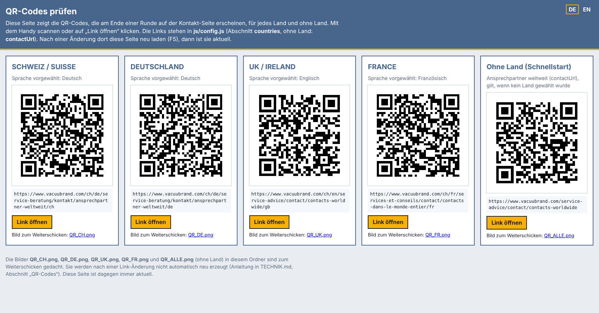

- Die fünfte Karte **„Ohne Land (Schnellstart)“** zeigt den Code, der kommt, wenn kein Land gewählt wurde: die Seite mit den Ansprechpartnern weltweit (alle Länder).
- Oben rechts lässt sich die Seite auf Englisch umstellen (DE / EN).
- Die Links stehen in `js/config.js` im Abschnitt `countries` (ohne Land: `contactUrl`) und lassen sich dort austauschen. Die Prüfseite ist danach sofort aktuell (F5).
- Für E-Mails liegen die Bilder `QR_CH.png`, `QR_DE.png`, `QR_UK.png`, `QR_FR.png` und `QR_ALLE.png` (ohne Land) im gleichen Ordner. Diese Bilder werden nach einer Link-Änderung nicht von selbst neu erzeugt (siehe TECHNIK.md, Abschnitt „QR-Codes prüfen und Bilder neu erzeugen“).

---

## 12. Datenschutz

- Alle Daten bleiben lokal auf dem Laptop, es wird nichts ins Internet gesendet.
- Einwilligungstext und Hinweise stehen in `js/i18n.js` (in allen drei Sprachen) und sollten vor der Messe kurz mit der Marketing-/Datenschutzstelle abgestimmt werden.
- Die englische und französische Fassung sind Entwürfe und brauchen die Freigabe für UK/Irland bzw. Frankreich.
- Nach der Messe im Admin-Bereich **Alle Daten löschen**.

---

## 13. Anpassen

Die meisten Einstellungen stehen gut kommentiert in **`js/config.js`**: Rundenzeit, Punkte, Zeitabzüge, Saug-Energie, Sprint, Item-Boni, Pumpen, Schutzausrüstung, Anmeldefelder, Länder mit ihren QR-Links und die Gerätesprache.

Alle **Texte** (Deutsch, Englisch, Französisch) stehen in **`js/i18n.js`**.

Datei mit einem Texteditor öffnen, ändern, speichern, im Browser **F5** drücken.

---

## 14. Hilfe bei Problemen

| Problem | Lösung |
|---|---|
| Bestenliste plötzlich leer | anderer Browser, anderer Ordner oder Browserdaten gelöscht. Sicherung (JSON) im Admin laden |
| Windows fragt nach „Einrastfunktion“ | kommt bei 5× Shift. In den Windows-Einstellungen unter Barrierefreiheit → Tastatur abschalten |
| Kein Ton | einmal eine Taste drücken (Browser-Regel), `M` prüfen, Lautstärke am Laptop |
| Controller reagiert nicht | einmal eine Taste am Controller drücken, USB neu einstecken, anderen USB-Port versuchen |
| Export lädt nichts herunter | Inhalt aus dem Textfeld im Admin kopieren und in eine Textdatei einfügen |
| Spiel ruckelt | andere Programme schliessen, Netzteil einstecken (Energiesparmodus drosselt) |
| Tablet zeigt nur Spitzname | Link ohne `?messe` geöffnet. Mit **…/vacuubrand-game/?messe** neu öffnen |

---

## Technik

Reines HTML + JavaScript + Canvas, keine Installation, keine Internetverbindung. Alles Technische (Aufbau, Dateien, Spielmechanik, Datenformat, Anpassungen) steht in **[TECHNIK.md](TECHNIK.md)**, alle Spieltexte mit Korrekturvorschlägen in **[TEXTE.md](TEXTE.md)**.

Alle Screenshots zeigen erfundene Beispieldaten.
