# 📖 Professor Vacuumus: Guide for Booth Staff

[Deutsch](ANLEITUNG.md) · **English**

This guide explains step by step how the trade show game works at the booth: starting it, registering visitors, letting them play, finding the winners and saving the contacts in the evening. No technical knowledge needed.

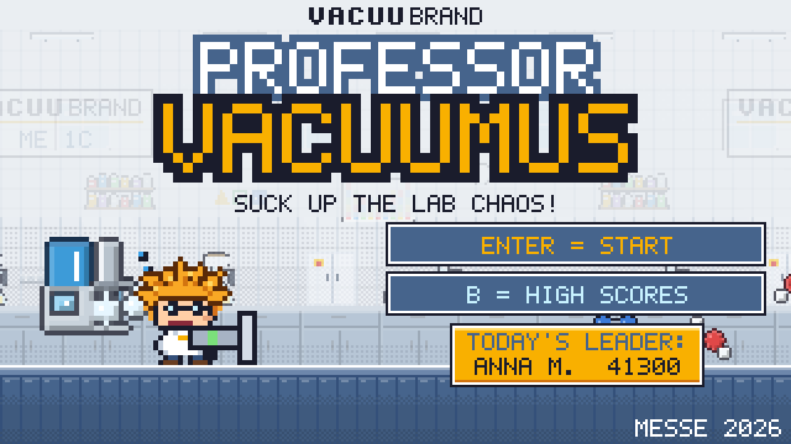

## Contents

1. [The essentials at a glance](#1-the-essentials-at-a-glance)
2. [Download and installation](#2-download-and-installation)
3. [Starting the game (laptop)](#3-starting-the-game-laptop)
4. [Tablet at the booth](#4-tablet-at-the-booth)
5. [Flow at the booth, step by step](#5-flow-at-the-booth-step-by-step)
6. [Controls](#6-controls)
7. [The game explained (for visitors' questions)](#7-the-game-explained-for-visitors-questions)
8. [Quick start without registration](#8-quick-start-without-registration)
9. [Admin area](#9-admin-area)
10. [Languages and countries](#10-languages-and-countries)
11. [Checking the QR codes](#11-checking-the-qr-codes)
12. [Data protection](#12-data-protection)
13. [Customising](#13-customising)
14. [Troubleshooting](#14-troubleshooting)

---

## 1. The essentials at a glance

| When | What to do |
|---|---|
| **Before the show** | Play through once, change the admin PIN, enter the show name and prizes, delete the reference data |
| **Every morning** | Double-click the start file, check the sound, plug in the controller |
| **During the show** | Talk to visitors, let them choose their country, help with the registration, show the QR code after the round |
| **Every evening** | In the admin area export **Leads (CSV/Excel)** and copy the file to a USB stick |
| **After the show** | Last export, then **Delete all data** in the admin area |

> [!TIP]
> A round lasts **2 minutes**. There is no game over: hits only cost time. So every visitor gets a sense of achievement.

> [!WARNING]
> The data is stored only in the browser of this device. Clearing the browser history or cookies also deletes the high scores and the contacts. That is why you should export every evening.

---

## 2. Download and installation

The ready-made download version is on GitHub: **[Download the latest version](https://github.com/GSB-Deleven/vacuubrand-game/releases)**.
At the bottom under "Assets", download `Professor-Vacuumus-v….zip` (not "Source code").

| System | How |
|---|---|
| 🪟 Windows | Right-click the ZIP → **Extract All**. Do not start it from inside the ZIP. In the folder `Professor-Vacuumus`, double-click `▶ START Windows.bat`. If Windows says "Windows protected your PC": **More info** → **Run anyway** |
| 🍎 Mac | Double-click the ZIP (it unpacks automatically). The first time, start `▶ START Mac.command` with right-click → **Open** → Open. If it says "permission denied": type `chmod +x ` in Terminal, drag the file into the window, press Enter |
| 🍓 Raspberry Pi / Linux | Unzip it (right-click → Extract Here, or in a terminal `unzip Professor-Vacuumus-v….zip`). Double-click `▶ START Linux + Raspberry Pi.sh`. If it does not start: in a terminal inside the folder run `chmod +x *.sh raspberry-pi/*.sh`. Automatic start when switched on: [raspberry-pi/README.md](raspberry-pi/README.md) (German) |

The running version is shown in small print at the top of the admin area (e.g. "Version 0.9.2").

> [!IMPORTANT]
> **For a new version:** first back up the high scores in the admin area (JSON), then put the new folder in the **same place** (replace the old one), otherwise the game cannot see the existing high score list. If needed, load the backup again in the admin area.

---

## 3. Starting the game (laptop)

The game needs no installation and no internet.

1. Copy the unpacked folder (or the whole game folder) onto the show laptop (e.g. onto the desktop).
2. Double-click the matching start file:

| System | Start file (double-click) |
|---|---|
| 🪟 Windows | `▶ START Windows.bat` (Edge in full screen) |
| 🍎 Mac | `▶ START Mac.command` (Chrome/Edge in full screen, otherwise Safari). First time: right-click → **Open** → Open |
| 🐧 Linux / 🍓 Raspberry Pi | `▶ START Linux + Raspberry Pi.sh` (Chromium in full screen). Automatic start when switched on: see [raspberry-pi/README.md](raspberry-pi/README.md) (German) |
| all | if in doubt, simply double-click `index.html` |

3. To quit: **Alt + F4** (Mac: **Cmd + Q**).

Works in Edge, Chrome and Firefox.

> [!IMPORTANT]
> **Always use the same browser and the same folder.** Otherwise the game cannot see the existing high score list.

---

## 4. Tablet at the booth

1. On the tablet, open **https://gsb-deleven.github.io/vacuubrand-game/?messe** in the browser.
2. Add it once **"to the Home Screen"** (iPad: share icon → "Add to Home Screen"; Android: menu ⋮ → "Install app"). It then starts like an app in full screen and also works without Wi-Fi.
3. Hold the tablet sideways. The on-screen buttons appear on the first tap.
4. **Admin area:** press the VACUUBRAND logo at the top for 3 seconds, then enter the PIN.
5. The data is stored only on this tablet. Export it via the admin area as on the laptop ("Copy content" also works if the download fails).

> [!WARNING]
> **`?messe`** at the end of the link is important. Without it the online demo starts: it only asks for a nickname, collects no contact data and has no admin area.

<table>
<tr>
<td width="60%">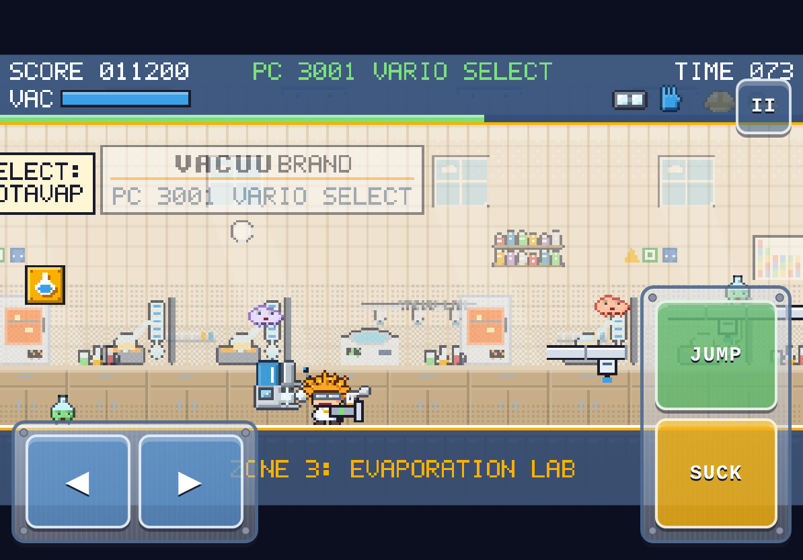 On the tablet: ◀ ▶ on the left to walk, JUMP and SUCK on the right, pause at the top right.</td>
<td width="40%">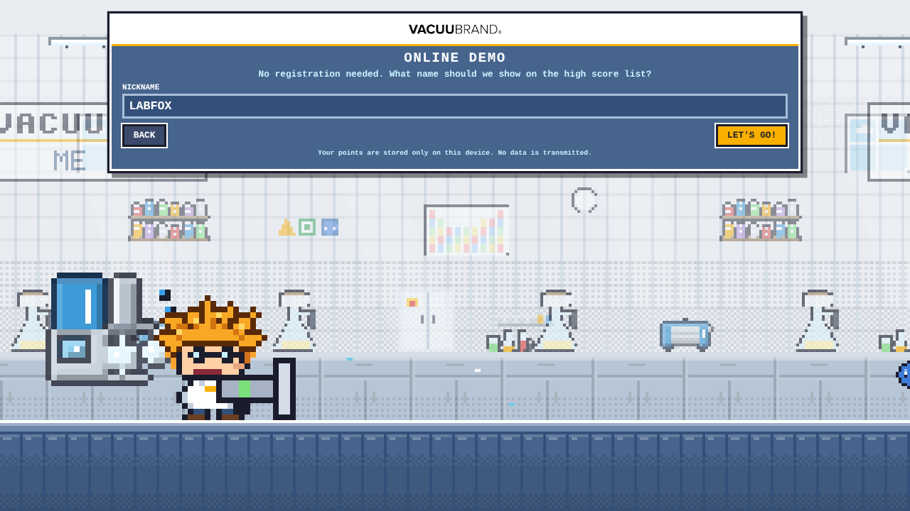 This is the online demo (without <code>?messe</code>): nickname only.</td>
</tr>
</table>

---

## 5. Flow at the booth, step by step

### Step 1: Title screen

The title screen runs a demo that attracts visitors. **Enter** (or a click on the button) starts, **B** shows the high scores.

The title screen is **always in English** (e.g. "B = HIGH SCORES"), so it fits every show. From the country selection on, the player's language applies.

### Step 2: Choose country and language

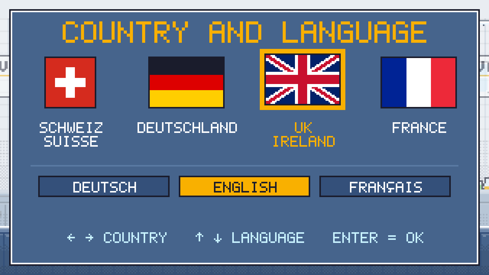

Four flags (Switzerland, Germany, UK/Ireland, France), below them the row LANGUAGE: DEUTSCH · ENGLISH · FRANÇAIS and at the bottom the big **START** button.

1. **Pick a flag:** this only marks the country and sets the matching language right away (Switzerland and Germany: German, UK: English, France: French). It does not start yet.
2. **Change the language (only if needed):** e.g. a visitor from French-speaking Switzerland picks the Swiss flag and then FRANÇAIS. Picking a flag again switches back to that flag's language.
3. Press **START**: now the registration opens in the chosen language.

- **Keyboard/gamepad:** ↑ ↓ moves between the three rows (flags, language, START), ← → chooses within the row, Enter starts from anywhere.
- **Tablet/phone:** tap a flag, tap a language if needed, then tap START.
- After 60 seconds without input the game returns to the title screen.

### Step 3: Register

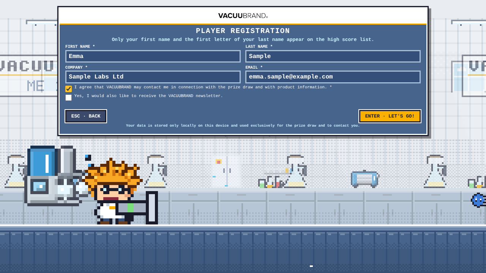

First name, last name, company, email and consent are required, the newsletter is optional. The form appears in the chosen language. Registration only works with a keyboard (or with the on-screen keyboard on the tablet).

> [!TIP]
> It works best if booth staff type in the details while the visitor talks. That is quicker and gives you a conversation starter right away.

### Step 4: Short instructions, then play

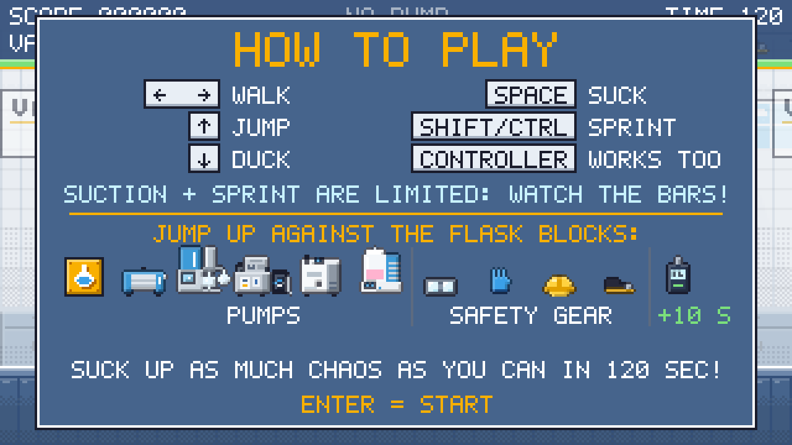

The instructions show the keys, pumps and safety gear. **Enter** continues, then the game counts down 3, 2, 1 and the round starts.

### Step 5: Result with medals

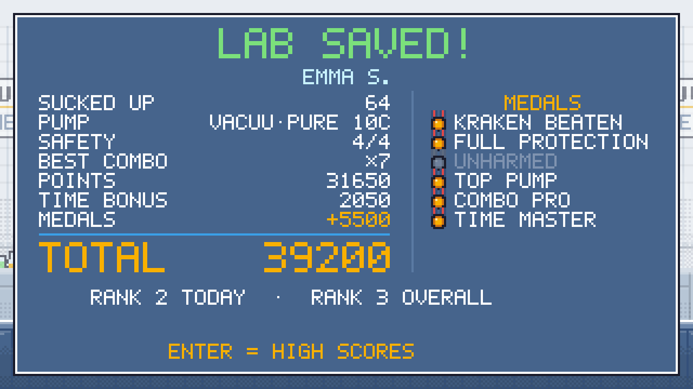

Points, time bonus, medals and the ranking for today and for the whole show.

### Step 6: Contact page with QR code

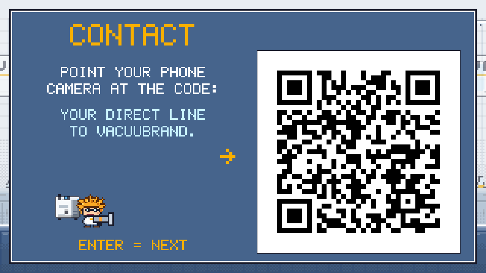

A large QR code leads to the contacts for the chosen country. The page stays on screen until someone presses Enter, taps or presses a button, so visitors have time to scan it.

### Step 7: High scores

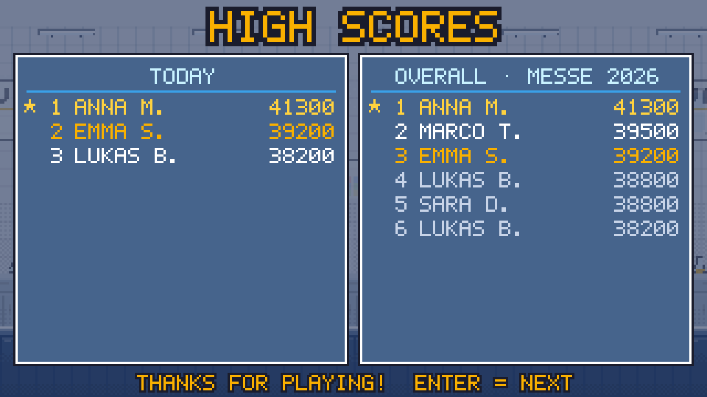

The public high score list shows only **"First name + initial"**. Anyone who plays several times (same email) is listed with their best result. After 20 seconds the game returns to the title screen.

---

## 6. Controls

### Keyboard

| Key | Action |
|---|---|
| ← → | walk |
| ↑ | jump |
| ↓ | duck |
| Space (hold) | suck: the **VAC** bar empties, then let it cool down briefly |
| Shift or Ctrl (hold) | sprint: watch the **SPRINT** bar |
| Enter | start / confirm |
| Esc | pause / back |
| M | sound on/off |
| F | full screen (on the title screen) |
| B | high scores on/off (on the title screen) |

### Gamepad and joystick

Xbox/USB gamepads and simple USB joysticks are detected automatically when plugged in ("CONTROLLER CONNECTED"; you may need to press a button once). The keyboard keeps working.

| Gamepad (Xbox layout) | Joystick | Action |
|---|---|---|
| Stick / D-pad | Stick | walk, ↑ jump, ↓ duck |
| A or Y | button 2 / 3 | jump |
| B or X | fire button | suck |
| LB / RB / LT / RT | further buttons | sprint |
| Start / A | fire button | start / next |
| Start or Back | button 9 / 10 | pause on/off |

> [!TIP]
> **Buttons in the wrong place?** (e.g. arcade joystick) In the admin area under **Controller / joystick → Set up controller**, press jump, suck, sprint and start one after the other. The game remembers the mapping for this controller model.

### Touch (tablet and phone)

| On-screen button | Action |
|---|---|
| ◀ ▶ (left) | walk |
| JUMP (right, top) | jump |
| SUCK (right, bottom) | suck |
| both at once | press on the seam between JUMP and SUCK |
| II (top right) | pause |
| Tap | start / next |

There is no sprinting or ducking on touch screens.

### Good to know

- A round can only be aborted with **Esc → Enter** on the keyboard, so that players cannot abort by accident.
- If someone presses Shift 5 times, Windows asks about "Sticky Keys". Switch it off under *Settings → Accessibility → Keyboard → Sticky Keys* (disable the shortcut). Sprinting also works with Ctrl.

---

## 7. The game explained (for visitors' questions)

The crazy professor (orange fuzzy hair, round glasses, just like our mascot) uses his suction gun to clean up the lab chaos. From the **flask blocks** he gets ever stronger pumps, safety gear and special devices. The levels show real pump applications.

### The five labs

| Zone | Device | Applications / enemies |
|---|---|---|
| 1 Filtration lab | **ME 1C** | Filtration: filtrate drops, particles, filter paper, test tubes, H₂O |
| 2 Cell culture lab | **BVC professional** (special) | Liquid aspiration: culture medium, Petri dish slime, well plates, H₂O₂ |
| 3 Evaporation lab | **PC 3001 VARIO select** | Rotavap, vacuum concentrator, drying oven: solvent vapour, hot vapour, round flasks, measuring beakers, Eppis, methanol, ethanol |
| 4 Chemistry lab | **MD 4C VARIO select** | Distillation and drying: acid vapour, separating funnels, solvent vapour, methanol, ethanol |
| 5 High vacuum pilot plant | **VACUU·PURE 10C** | Oil-free drying (freeze drying, Schlenk line, turbo backing): ice crystals, O₂, N₂, H₂O, Schlenk flasks, argon cylinders, **steam kraken** (boss) |

<table>
<tr>
<td width="33%">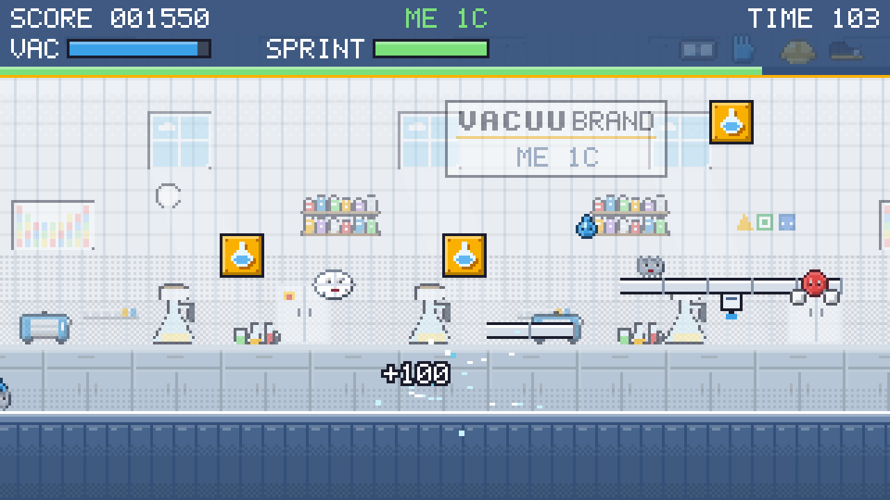 1 Filtration lab, <b>ME 1C</b></td>
<td width="33%">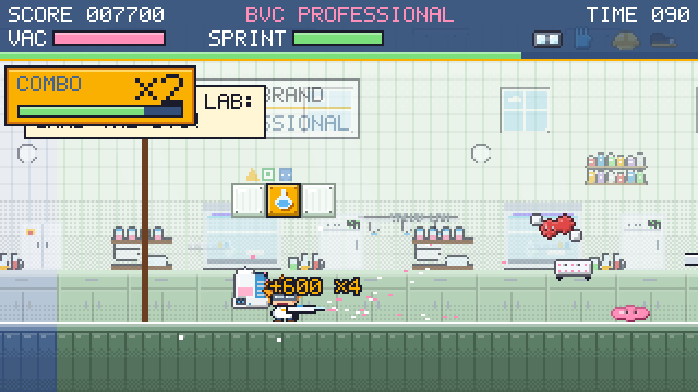 2 Cell culture lab, <b>BVC professional</b></td>
<td width="33%">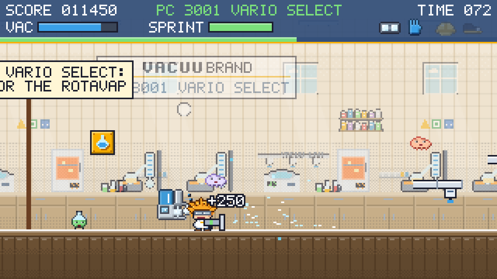 3 Evaporation lab, <b>PC 3001 VARIO select</b></td>
</tr>
<tr>
<td>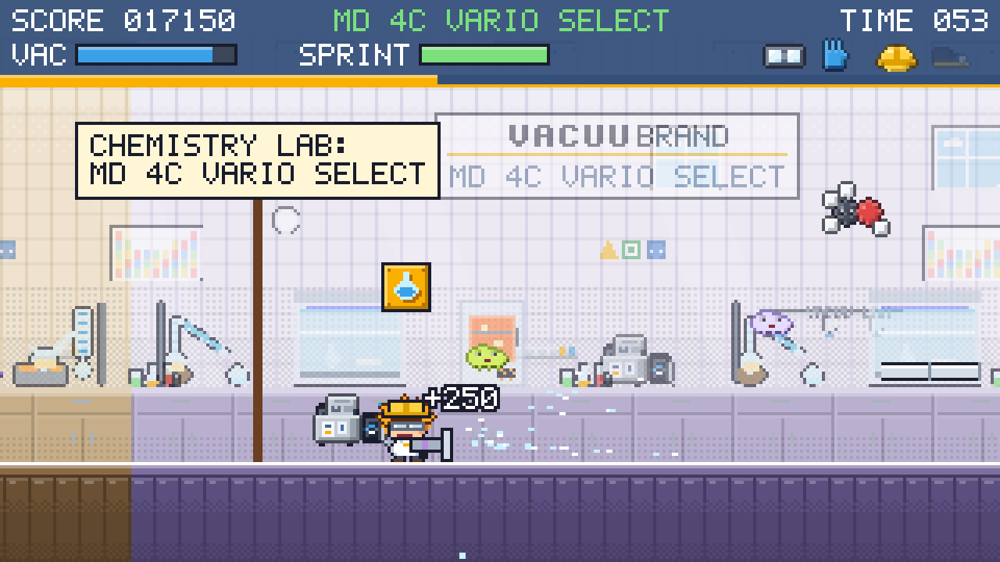 4 Chemistry lab, <b>MD 4C VARIO select</b></td>
<td>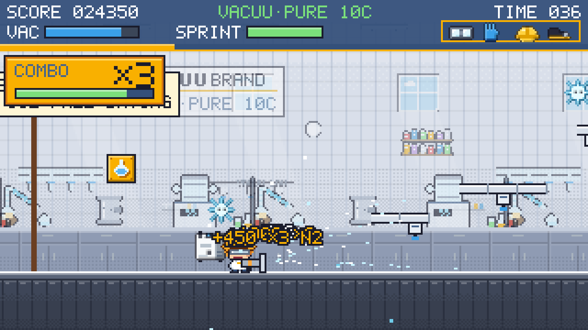 5 High vacuum pilot plant, <b>VACUU·PURE 10C</b></td>
<td>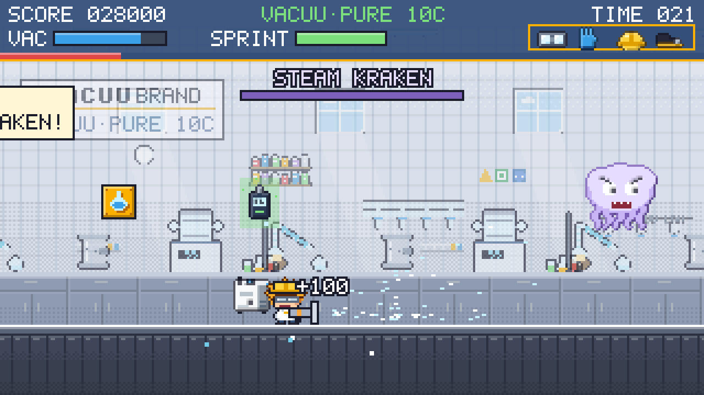 Boss: <b>steam kraken</b></td>
</tr>
</table>

The platforms you can jump through from below are **VACUU·LAN** lines.

### Items from the flask blocks

The items run away like the mushrooms in Mario: chase them or simply suck them in!

| Item | Effect |
|---|---|
| Pump ME 1C → PC 3001 VARIO select → MD 4C VARIO select → VACUU·PURE 10C | longer range, sucks up heavier things |
| **BVC professional** pump (cell culture) | in the whole cell culture lab: BVC on the back, the gun becomes the **VHC hand piece**, sucks up everything (liquids, vapours and all the lab chaos) with no energy limit and double points; when leaving the lab, back to the normal pump |
| Safety goggles | hits cost only 1 instead of 3 seconds |
| Gloves | suction energy recharges twice as fast |
| Safety helmet | headbutt enemies from below |
| Safety shoes | destroy enemies by jumping on them |
| all 4 = **full protection** | enemies can no longer hurt you |
| VACUU·VIEW extended (hidden, 3×) | "time vacuum": +10 seconds |

### Time, combo and medals

- **Time:** a round lasts **120 seconds**. Each new piece of safety gear gives +2 seconds. Hits cost time (no game over). The time also runs down as a coloured **time bar** (green → yellow → red).
- **Goal:** whoever sucks up the steam kraken and reaches the exit gets the remaining time as a bonus.
- **Combo:** sucking something up again within 2 seconds builds a streak: points ×2, ×3 … up to **×8**. The golden combo box at the top left shows the level and a running timer. A hit ends the streak.
- **Music:** each zone has its own music, the steam kraken has its own boss theme.

**Medals** at the end of the round (bonus points count towards the total):

| Medal | Condition | Bonus |
|---|---|---|
| Kraken beaten | steam kraken sucked up | +2000 |
| Full protection | all 4 pieces of safety gear | +1000 |
| Unharmed | no hit (at least 10 things sucked up) | +1500 |
| Top pump | VACUU·PURE 10C reached | +1000 |
| Combo pro | combo ×5 or higher | +1000 |
| Time master | all 3 VACUU·VIEW found | +500 |

---

## 8. Quick start without registration

For testing or demos: on the title screen, the high scores or in the registration form press **Ctrl + Shift + Enter**. The game starts immediately with the player **ADMIN**.

> [!NOTE]
> These test rounds are **not** saved and appear neither on the high score list nor in the export. The country selection is skipped: the device language is used and the QR code at the end shows the contacts worldwide (all countries).

---

## 9. Admin area

On the title screen press **Ctrl + Shift + A** (tablet: 3 seconds on the logo), enter the PIN.

> [!WARNING]
> The default PIN is **1234**. Please change it before the show!

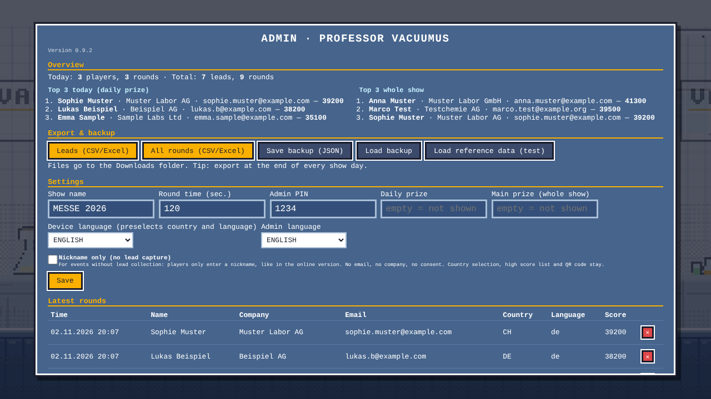

| Section | What it does |
|---|---|
| **Version** | shown in small print below the heading (e.g. "Version 0.9.2"), so you can see which version is running |
| **Overview** | **Top 3 today** (daily prize) and **Top 3 whole show** with full contact details |
| **Export & backup** | Export **Leads (CSV/Excel)** and **All rounds (CSV/Excel)**, saved in the Downloads folder. **Save / load backup** (JSON), e.g. to move data to another laptop |
| **Settings** | Show name, round time, PIN, daily prize and main prize (prizes appear on the title screen and the high scores) |
| **Device language** | decides which country and language are preselected in the country selection (German → Switzerland, English → UK, French → France). At a show in the UK, for example, set it to English. The title screen always stays in English (`titleLang` in `js/config.js`) |
| **Admin language** | German or English, e.g. for the team in the UK |
| **Nickname only (no lead capture)** | Tick box in the settings, then **Save**. For events that are just for fun: people only enter a nickname, like in the online version. No email, no company, no consent, no newsletter. Country selection, high scores and the QR code at the end stay. See below |
| **Controller / joystick** | **Set up controller** if buttons are in the wrong place |
| **Latest rounds** | delete single rounds (click ✕ twice) |
| **Danger zone** | **Delete all data** after the show (type DELETE into the field) |

- The export additionally contains **country** (CH, DE, UK, FR) and **language** (de, en, fr) for each round and each lead.
### Nickname only (event without leads)

As long as the switch is on, a yellow bar **NICKNAME ONLY IS ACTIVE** is shown at the top of the admin area. The setting is kept after a restart.

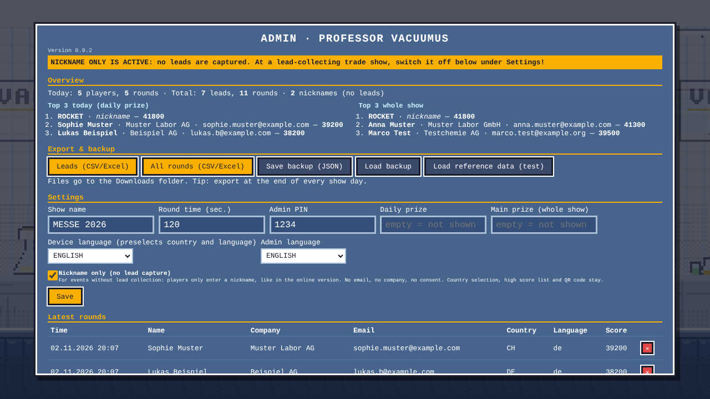

- The high score list shows the nickname.
- The **Leads** export only contains real registrations, no nicknames. In the **All rounds** export the column **Type** shows whether it was a **Lead** or a **Nickname**; for nicknames, name, company and email stay empty.
- The overview counts nicknames separately ("nicknames (no leads)").

> [!WARNING]
> At a show where leads are collected, **always switch it off**. Otherwise nobody registers.

- **Load reference data (test):** loads sample data with invented people (folder `daten/`: JSON and CSV examples) to try out the high scores and export. Remove it with "Delete all data" before the show.
- After every export the content also appears in a text field with "Copy content". Handy if the browser does not allow downloads (e.g. in the online preview).

> [!TIP]
> Export the leads at the end of every show day. The data is stored only in the browser storage of this laptop.

---

## 10. Languages and countries

The game is available in **German, English and French**. Before every round the player picks a **country** (Switzerland, Germany, UK/Ireland, France) and the **language**. The country decides which contact page the QR code at the end leads to.

- Which country is preselected depends on the **device language** in the admin area.
- The title screen is in English for everyone.
- The English and French texts are drafts and still have to be approved by marketing.

---

## 11. Checking the QR codes

The folder `qr/` contains a check page: double-click **`qr/index.html`** (works without internet) or open **https://gsb-deleven.github.io/vacuubrand-game/qr/** online. It shows the QR code for each country in large size, together with the link as text and as a clickable link. Simply scan it with a phone and check that the right page opens.

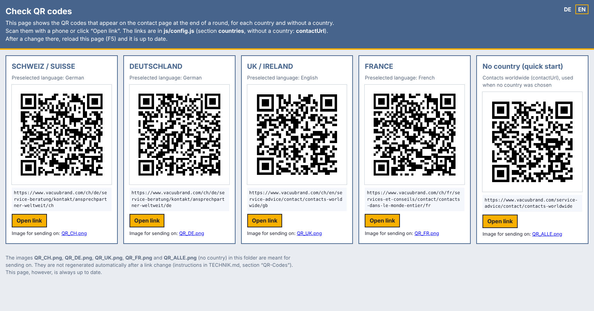

- The fifth card **"No country (quick start)"** shows the code used when no country was chosen: the page with the contacts worldwide (all countries).
- The page can be switched between German and English at the top right (DE / EN).
- The links are in `js/config.js` in the `countries` section (no country: `contactUrl`) and can be replaced there. The check page is up to date immediately afterwards (F5).
- For emails, the images `QR_CH.png`, `QR_DE.png`, `QR_UK.png`, `QR_FR.png` and `QR_ALLE.png` (no country) are in the same folder. These images are not regenerated automatically after a link change (see TECHNIK.md, section "QR-Codes prüfen und Bilder neu erzeugen").

---

## 12. Data protection

- All data stays locally on the laptop, nothing is sent to the internet.
- The consent text and notices are in `js/i18n.js` (in all three languages) and should be agreed with marketing / data protection before the show.
- The English and French versions are drafts and need approval for the UK/Ireland and France respectively.
- After the show, use **Delete all data** in the admin area.

---

## 13. Customising

Most settings are well commented in **`js/config.js`**: round time, points, time penalties, suction energy, sprint, item bonuses, pumps, safety gear, registration fields, countries with their QR links and the device language.

All **texts** (German, English, French) are in **`js/i18n.js`**.

Open the file in a text editor, change it, save it and press **F5** in the browser.

---

## 14. Troubleshooting

| Problem | Solution |
|---|---|
| High scores suddenly empty | different browser, different folder or browser data deleted. Load a backup (JSON) in the admin area |
| Windows asks about "Sticky Keys" | happens after pressing Shift 5 times. Switch it off in the Windows settings under Accessibility → Keyboard |
| No sound | press a key once (browser rule), check `M`, check the laptop volume |
| Controller does not react | press a button on the controller once, plug the USB in again, try another USB port |
| Export downloads nothing | copy the content from the text field in the admin area and paste it into a text file |
| Game stutters | close other programs, plug in the power supply (power saving mode slows things down) |
| Tablet only asks for a nickname | link opened without `?messe`. Open it again with **…/vacuubrand-game/?messe** |

---

## Technical details

Plain HTML + JavaScript + canvas, no installation, no internet connection. Everything technical (structure, files, game mechanics, data format, customisation) is in **[TECHNIK.md](TECHNIK.md)** (German), all game texts with translation drafts in **[TEXTE.md](TEXTE.md)** (German, with English and French columns).

All screenshots show invented sample data.
