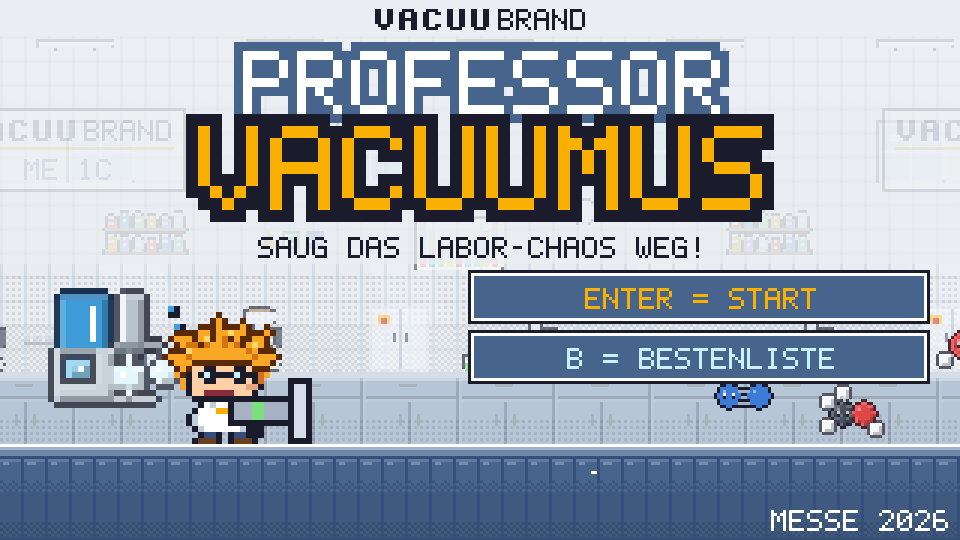
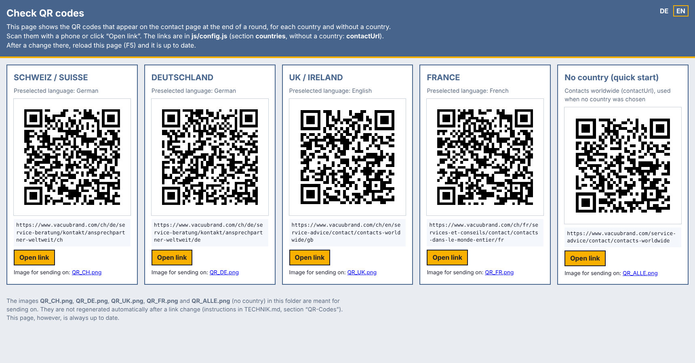

# 🧪 Professor Vacuumus

🇩🇪 **Deutsche Fassung: [README.md](README.md)**

> [!NOTE]
> **🧪 Try it online: [gsb-deleven.github.io/vacuubrand-game](https://gsb-deleven.github.io/vacuubrand-game/)**
>
> For trying it out only. Use the offline version at the show.
>
> 

> 
Differences from the show version (expand)

>
> | | 🧪 Online test | 🎪 Show version (offline) |
> |---|---|---|
> | Start | link in the browser | copy the folder, double-click `index.html` |
> | Registration | nickname only | first name, last name, company, email, consent |
> | Contacts / export | none | CSV/Excel export |
> | Admin area | no | yes, with PIN |
> | High scores | only on your own device | daily and show high scores at the booth |
> | Internet | needed (when loading the first time) | not needed |
> | The game itself | same | same |
>
> With **`?messe`** at the end of the link, the full booth version also runs online, e.g. on a tablet at the booth.
>
> 

### The VACUUBRAND trade show game: bring visitors to the booth, show products, collect contacts

*(Screenshots show the German version. The game itself also runs in English and French.)*

---

## 🎯 What is it about?

Professor Vacuumus is a short platformer in the style of the old Nintendo games. A crazy lab professor with wild orange hair cleans up the lab with his suction gun. On his back he carries a VACUUBRAND pump, which gets stronger and stronger during the round.

A round lasts **2 minutes**: long enough to be fun, short enough that no queue builds up at the booth.

Before playing, visitors register with their name, company and email. Whoever scores the most points wins a prize.

---

## 💡 What's in it for VACUUBRAND?

| | |
|---|---|
| 👀 **Attention** | A colourful demo runs on the screen all the time. It stands out in the aisle and draws people to the booth. |
| 📇 **Leads** | Every player enters first name, last name, company and email, with consent to be contacted. Newsletter sign-up is optional and recorded separately. |
| 🔬 **Products explained through play** | Each level is a real lab application with the matching pump. Visitors see ME 1C, BVC professional, PC 3001 VARIO select, MD 4C VARIO select and VACUU·PURE 10C in action. |
| 💬 **Conversation starter** | "Which pump did you have at the end?" is an easy way into a technical conversation. |
| 🏆 **Coming back** | There is a daily and an overall high score list. Anyone who narrowly lost often comes back. |

---

## 🕹️ How it works at the booth

1. **Choose country and language** 🌍 Four flags (Switzerland, Germany, UK/Ireland, France), plus German, English or French. The country decides where the QR code at the end leads.
2. **Register** 📝 First name, last name, company, email and the consent tick box, in the chosen language.
3. **Play** 🎮 Walk, jump and suck, with keyboard, gamepad, joystick or touch screen. Flask blocks release stronger pumps and safety gear.
4. **Result and medals** 🥇 Points, time bonus, medals and the ranking for today and for the whole show.
5. **Contact** 📲 A large QR code leads to the VACUUBRAND contacts in the player's country. It stays on screen until someone clicks on.
6. **High scores** 🏆 Publicly only "First name + initial" is shown, no full names and no companies.

---

## 🧪 Five labs, five pumps

| Level | Pump | Application in the game |
|---|---|---|
| 1️⃣ Filtration lab | **ME 1C** | Filtration |
| 2️⃣ Cell culture lab | **BVC professional** with VHC hand piece | Liquid aspiration from well plates and Petri dishes |
| 3️⃣ Evaporation lab | **PC 3001 VARIO select** | Rotavap, vacuum concentrator, drying oven |
| 4️⃣ Chemistry lab | **MD 4C VARIO select** | Chemistry diaphragm pump for distillation and drying, the controller regulates automatically |
| 5️⃣ High vacuum pilot plant | **VACUU·PURE 10C** | Oil-free drying: freeze drying, Schlenk line, turbo backing |

At the end the **steam kraken** 🐙 is waiting. Only the VACUU·PURE 10C can handle it.

The platforms in the game are **VACUU·LAN** lines, and the **VACUU·VIEW extended** gives 10 extra seconds as a "time vacuum". This way further products appear along the way.

---

## 🌍 Three languages, four countries

The game runs in **German, English and French** (a wish of the UK team). Before every round visitors choose their country and language, which suits international shows:

- 🇨🇭 Switzerland (German, French or English), 🇩🇪 Germany, 🇬🇧 UK/Ireland, 🇫🇷 France
- The QR code at the end leads to the contacts for the chosen country
- The title screen is in English for everyone. Booth staff set the device language (preselection in the country selection) and the language of the admin area (German/English)
- The export contains the country and language of each player
- Without a country selection (quick start) the QR code leads to the contacts worldwide
- The QR codes can be checked on a separate page: [qr/index.html](https://gsb-deleven.github.io/vacuubrand-game/qr/)

The English and French texts are drafts and are still being reviewed by marketing.

---

## ⭐ Features

🔋 **Stronger pumps.** Each new pump has more range and more suction power.

🦺 **Safety gear.** Safety goggles, gloves, safety helmet and safety shoes each give an advantage. Whoever has all four plays with "full protection". Lab safety becomes part of the game along the way.

🔥 **Combo streaks.** Sucking things up quickly one after the other gives up to eight times the points.

🥇 **Six medals** with bonus points, e.g. "Kraken beaten", "Full protection" or "Unharmed".

⏱️ **Time bar.** The remaining time runs down as a coloured bar, from green via yellow to red.

🎵 **8-bit music and sound.** Every lab has its own tune, the boss its own theme.

🎮 **Keyboard, gamepad, joystick and touch.** An Xbox or USB controller is detected automatically.

🔬 **Real lab enemies.** Test tubes, Eppis, round flasks, well plates, solvent vapour and molecules such as H₂O, O₂, N₂ or ethanol as ball-and-stick models.

---

## 🏆 High scores and prizes

- **Daily high scores**, so that there is a winner every day
- **Overall high scores** for the whole show for a main prize
- Anyone who plays several times counts with their best result
- In the admin area, booth staff see the top 3 of today and of the whole show with full contact details

---

## 📇 Leads and data protection 🔒

- All data stays **only on the show laptop**. Nothing is sent to the internet.
- Export as an **Excel file (CSV)**: one list with all contacts, one with all rounds played, each with country and language.
- Consent is required, the newsletter is optional and ticked separately.
- After the show one button deletes all data.
- 👉 The consent text should be checked by data protection before first use, for the UK/Ireland and France separately.

---

## ⬇️ Download

The ready-made version to download: **[Professor Vacuumus, latest version](https://github.com/GSB-Deleven/vacuubrand-game/releases/latest)**

1. Under "Assets" at the bottom, download `Professor-Vacuumus-v….zip`.
2. Unzip it (Windows: right-click → "Extract All", Mac: double-click, Raspberry Pi: right-click → "Extract Here").
3. Double-click the start file: `▶ START Windows.bat`, `▶ START Mac.command` or `▶ START Linux + Raspberry Pi.sh`.

Details and help if something does not start: [GUIDE.en.md](GUIDE.en.md#download-and-installation).

## 💻 What you need

| | |
|---|---|
| 🖥️ Hardware | A normal company laptop **or a tablet**. Next to a large screen or TV it looks best. |
| 🎮 Optional | A USB gamepad or joystick |
| 📦 Installation | None. Download and unzip (or copy the folder), double-click, done. |
| 🌐 Internet | Not needed, the game runs completely offline |
| 💰 Licences | None. The game is developed in-house, without third-party software or subscriptions. |

## 🌍 Runs on …

| Device | How |
|---|---|
| 💻 Windows laptop | `▶ START Windows.bat` |
| 🍎 Mac | `▶ START Mac.command` |
| 📱 iPad / iPhone | open the online link, then **Share → "Add to Home Screen"**: starts like an app in full screen, also offline |
| 🤖 Android tablet / phone | open the online link, menu → **"Install app"** |
| 🍓 Raspberry Pi / arcade cabinet | starts straight into the game when switched on, see [`raspberry-pi/README.md`](raspberry-pi/README.md) (German) |
| 🕹️ Joystick, gamepad, arcade buttons | plug in, done. If buttons are in the wrong place: **Set up controller** in the admin area |

| Version | Address | Purpose |
|---|---|---|
| 🎪 **Show (laptop)** | double-click `index.html` | booth with registration, high scores and contact export |
| 📱 **Show (tablet)** | [https://gsb-deleven.github.io/vacuubrand-game/?messe](https://gsb-deleven.github.io/vacuubrand-game/?messe) | as above, but on the tablet. Open once, "Add to Home Screen", then it also works without Wi-Fi |
| 🧪 **Online test** | [https://gsb-deleven.github.io/vacuubrand-game/](https://gsb-deleven.github.io/vacuubrand-game/) | **for testing only**: nickname only, no contact data, no data transfer |

---

📖 **Guide for booth staff** with controls, admin area, export and tips: [GUIDE.en.md](GUIDE.en.md)

🛠️ **Technical manual** (German): [TECHNIK.md](TECHNIK.md) · ✏️ **All texts in three languages**: [TEXTE.md](TEXTE.md)
