# 🧪 Professor Vacuumus

**Deutsch** · [English](README.en.md) · 🇫🇷 Le jeu existe aussi en français.

### Das VACUUBRAND Messespiel: Besucher an den Stand holen, Produkte zeigen, Kontakte sammeln

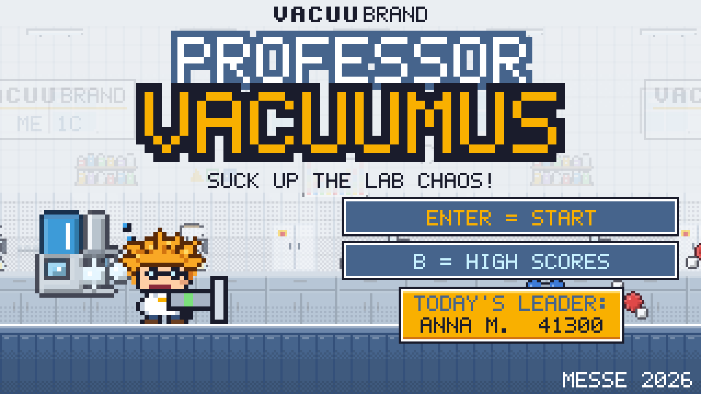

> [!NOTE]
> **🧪 Online testen: [gsb-deleven.github.io/vacuubrand-game](https://gsb-deleven.github.io/vacuubrand-game/)**
> Die Online-Version ist nur zum Ausprobieren. An der Messe läuft die Offline-Version mit Anmeldung und Export: [herunterladen](https://github.com/GSB-Deleven/vacuubrand-game/releases).
>
> 

> 
Unterschiede zur Messe-Version (aufklappen)

>
> | | 🧪 Online-Test | 🎪 Messe-Version (offline) |
> |---|---|---|
> | Start | Link im Browser | ZIP herunterladen, entpacken, Doppelklick auf die Start-Datei |
> | Anmeldung | nur Spitzname | Vorname, Name, Firma, E-Mail, Einwilligung |
> | Kontakte / Export | keine | CSV/Excel-Export |
> | Admin-Bereich | nein | ja, mit PIN |
> | Bestenliste | nur auf dem eigenen Gerät | Tages- und Messe-Bestenliste am Stand |
> | Internet | nötig (beim ersten Laden) | nicht nötig |
> | Spiel selbst | gleich | gleich |
>
> Mit **`?messe`** am Ende des Links läuft auch online die volle Stand-Version, z. B. auf einem Tablet am Stand.
>
> 

## Inhalt

- [Worum geht's?](#-worum-gehts)
- [Was bringt das VACUUBRAND?](#-was-bringt-das-vacuubrand)
- [So läuft eine Runde](#%EF%B8%8F-so-läuft-eine-runde)
- [Fünf Labore, fünf Pumpen](#-fünf-labore-fünf-pumpen)
- [Drei Sprachen, vier Länder](#-drei-sprachen-vier-länder)
- [Was alles drin ist](#-was-alles-drin-ist)
- [Bestenliste, Leads und Datenschutz](#-bestenliste-leads-und-datenschutz)
- [Herunterladen](#%EF%B8%8F-herunterladen)
- [Was es braucht und wo es läuft](#-was-es-braucht-und-wo-es-läuft)
- [Anpassbar für jede Messe](#%EF%B8%8F-anpassbar-für-jede-messe)
- [Nächste Schritte bis zur Messe](#-nächste-schritte-bis-zur-messe)
- [Weiterlesen und mitmachen](#-weiterlesen-und-mitmachen)

---

## 🎯 Worum geht's?

Professor Vacuumus ist ein kurzes Jump'n'Run im Stil der alten Nintendo-Spiele. Ein verrückter Laborprofessor mit wilden orangen Haaren räumt mit seiner Saugpistole das Labor auf. Auf dem Rücken trägt er eine VACUUBRAND Pumpe, und die wird im Lauf der Runde immer stärker.

Eine Runde dauert **2 Minuten**. Das ist lang genug, dass es Spass macht, und kurz genug, dass am Stand keine Schlange entsteht.

Vor dem Spielen melden sich die Besucher mit Namen, Firma und E-Mail an. Wer die meisten Punkte holt, gewinnt einen Preis.

---

## 💡 Was bringt das VACUUBRAND?

| | |
|---|---|
| 👀 **Aufmerksamkeit** | Auf dem Bildschirm läuft dauernd eine bunte Demo. Die fällt im Messegang auf und lockt Leute an den Stand. |
| 📇 **Leads** | Jeder Spieler gibt Vorname, Name, Firma und E-Mail an, mit Einwilligung zur Kontaktaufnahme. Die Anmeldung zum Newsletter ist freiwillig und wird separat erfasst. |
| 🔬 **Produkte spielerisch erklärt** | Jedes Level ist eine echte Laboranwendung mit der passenden Pumpe. Die Besucher sehen ME 1C, BVC professional, PC 3001 VARIO select, MD 4C VARIO select und VACUU·PURE 10C im Einsatz. |
| 💬 **Gesprächseinstieg** | „Welche Pumpe hattest du am Schluss?“ ist ein einfacher Einstieg ins Fachgespräch. |
| 🏆 **Wiederkommen** | Es gibt eine Tages- und eine Gesamt-Bestenliste. Wer knapp verloren hat, kommt oft nochmals vorbei. |

---

## 🕹️ So läuft eine Runde

<table>
<tr>
<td width="50%"><b>1. Land und Sprache wählen</b> 🌍 Vier Flaggen (Schweiz, Deutschland, UK/Irland, Frankreich), dazu Deutsch, Englisch oder Französisch. Das Land bestimmt, wohin der QR-Code am Ende führt.</td>
<td width="50%"><b>2. Anmelden</b> 📝 Vorname, Name, Firma, E-Mail und das Häkchen für die Einwilligung, in der gewählten Sprache. Im Hintergrund saugt der Professor schon mal Laborchaos weg.</td>
</tr>
<tr>
<td>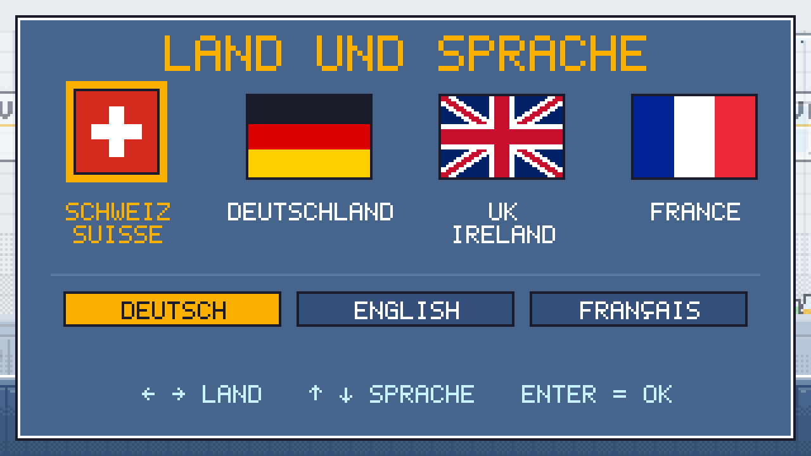</td>
<td>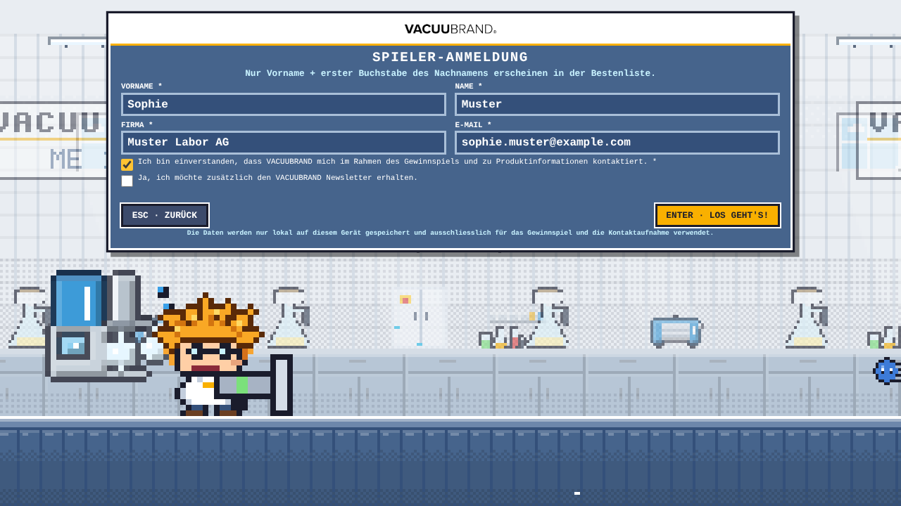</td>
</tr>
<tr>
<td><b>3. Kurz erklärt</b> 📋 Eine Seite zeigt Tasten, Pumpen und Schutzausrüstung. Danach zählt das Spiel 3, 2, 1 herunter.</td>
<td><b>4. Spielen</b> 🎮 Laufen, springen und saugen, mit Tastatur, Gamepad, Joystick oder Touchscreen. Aus den Kolben-Blöcken kommen stärkere Pumpen und Schutzausrüstung.</td>
</tr>
<tr>
<td>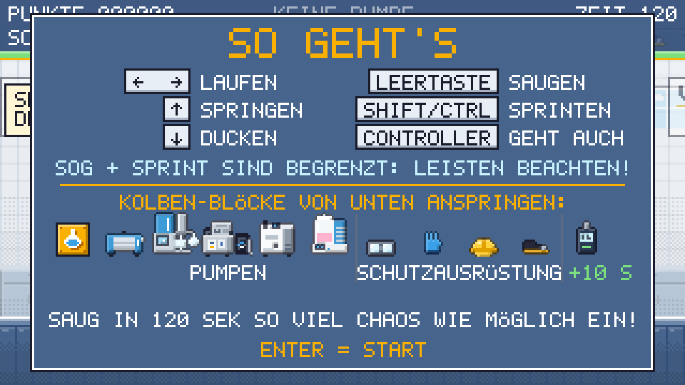</td>
<td>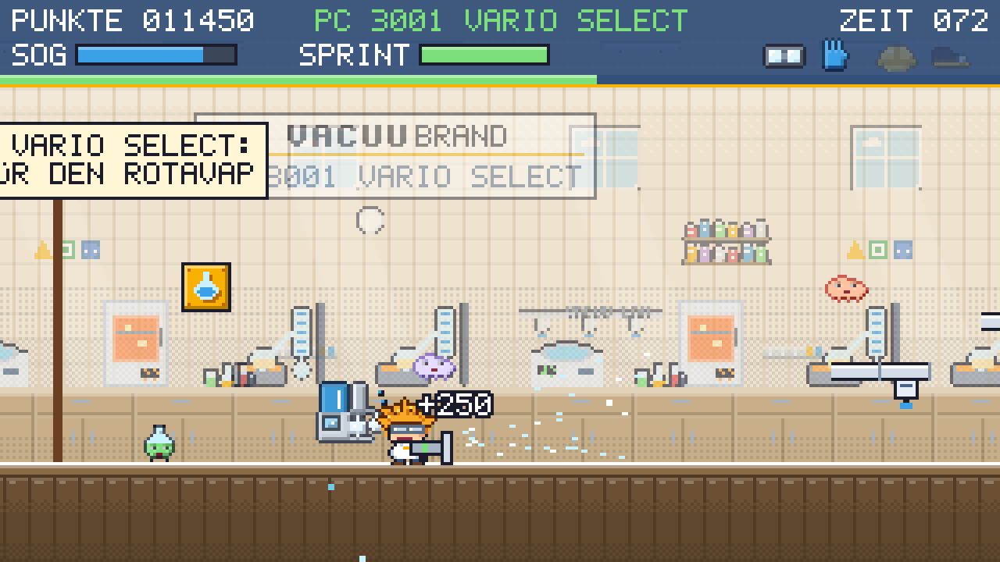</td>
</tr>
<tr>
<td><b>5. Ergebnis und Medaillen</b> 🥇 Punkte, Zeitbonus, Medaillen und die Platzierung von heute und von der ganzen Messe.</td>
<td><b>6. Kontakt</b> 📲 Ein grosser QR-Code führt zu den VACUUBRAND Ansprechpartnern im Land des Spielers. Er bleibt stehen, bis jemand weiterklickt.</td>
</tr>
<tr>
<td>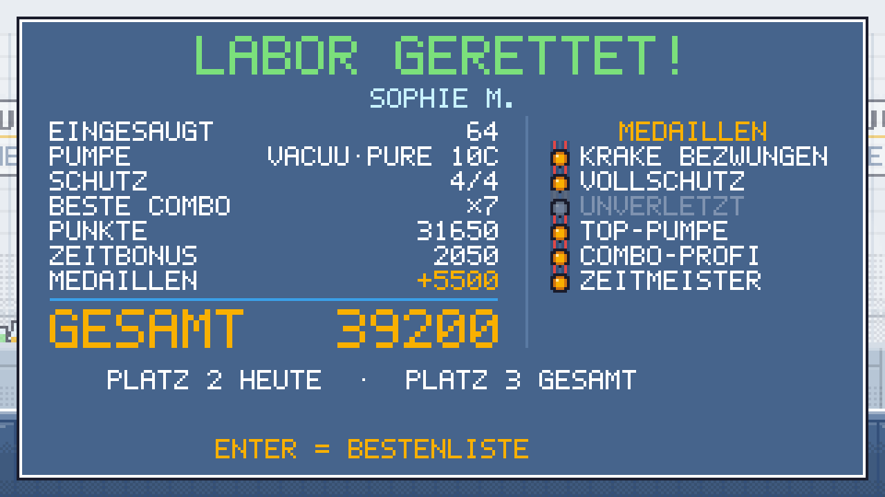</td>
<td>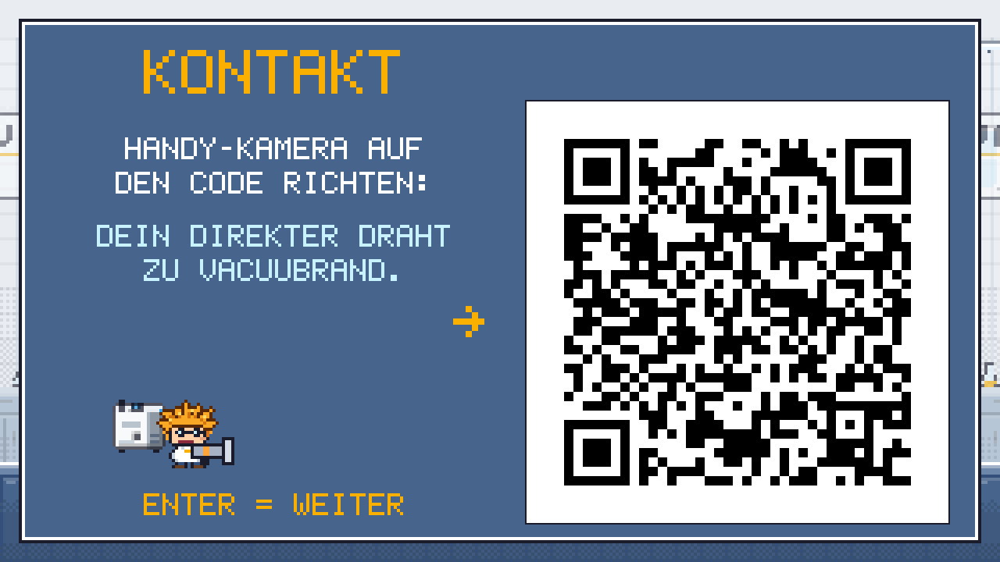</td>
</tr>
<tr>
<td><b>7. Bestenliste</b> 🏆 Öffentlich erscheint nur „Vorname N.“, also keine vollen Namen und keine Firmen.</td>
<td><b>8. Und wieder von vorn</b> 🔁 Danach geht es zurück zum Titelbild mit der Demo, bereit für den nächsten Besucher.</td>
</tr>
<tr>
<td>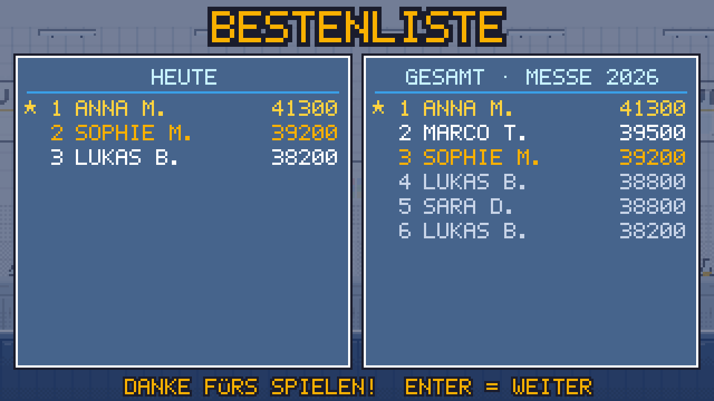</td>
<td></td>
</tr>
</table>

---

## 🧪 Fünf Labore, fünf Pumpen

| Level | Pumpe | Anwendung im Spiel |
|---|---|---|
| 1️⃣ Filtrationslabor | **ME 1C** | Filtration |
| 2️⃣ Zellkultur-Labor | **BVC professional** mit VHC-Handstück | Medienabsaugung aus Wellplatten und Petrischalen |
| 3️⃣ Verdampfer-Labor | **PC 3001 VARIO select** | Rotavap, Vakuum-Konzentrator, Trockenschrank |
| 4️⃣ Chemielabor | **MD 4C VARIO select** | Chemiefeste Membranpumpe für Destillation und Trocknung, der Controller regelt automatisch |
| 5️⃣ Hochvakuum-Technikum | **VACUU·PURE 10C** | Ölfreie Trocknung: Gefriertrocknung, Schlenk-Line, Turbo-Vorvakuum |

Am Schluss wartet die **Dampf-Krake** 🐙. Die schafft nur die VACUU·PURE 10C.

<table>
<tr>
<td width="33%">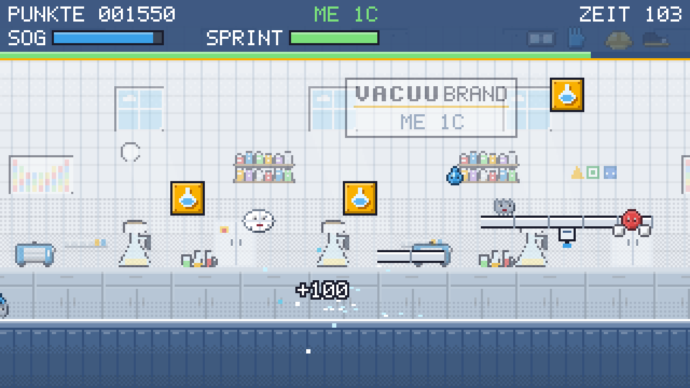 1️⃣ Filtrationslabor mit <b>ME 1C</b></td>
<td width="33%">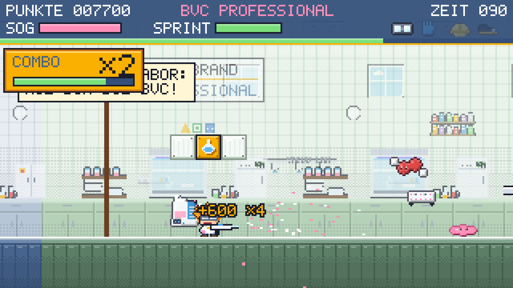 2️⃣ Zellkultur-Labor mit <b>BVC professional</b></td>
<td width="33%"> 3️⃣ Verdampfer-Labor mit <b>PC 3001 VARIO select</b></td>
</tr>
<tr>
<td>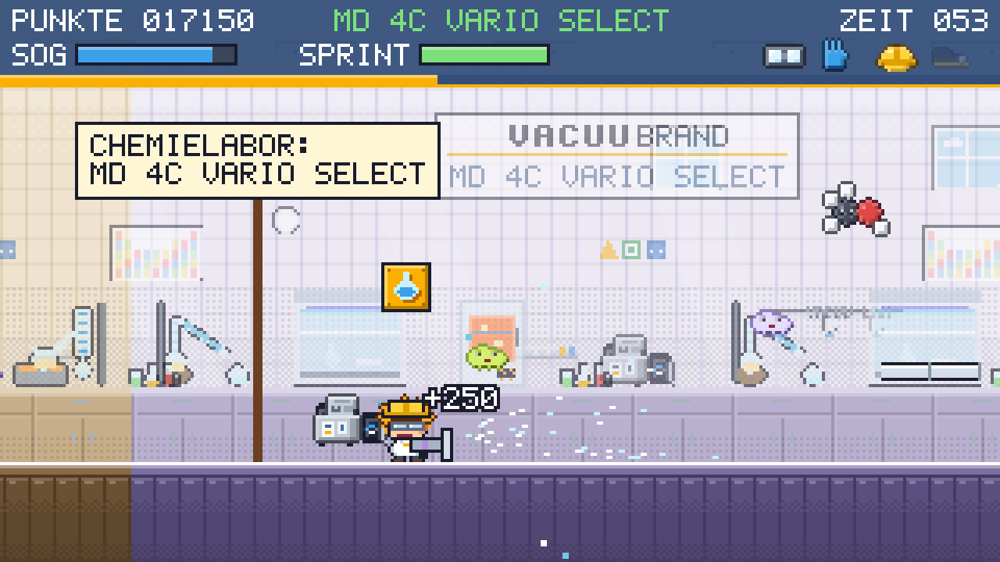 4️⃣ Chemielabor mit <b>MD 4C VARIO select</b></td>
<td>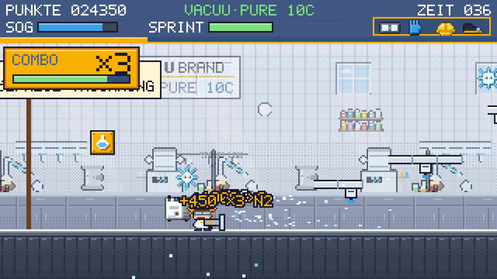 5️⃣ Hochvakuum-Technikum mit <b>VACUU·PURE 10C</b></td>
<td>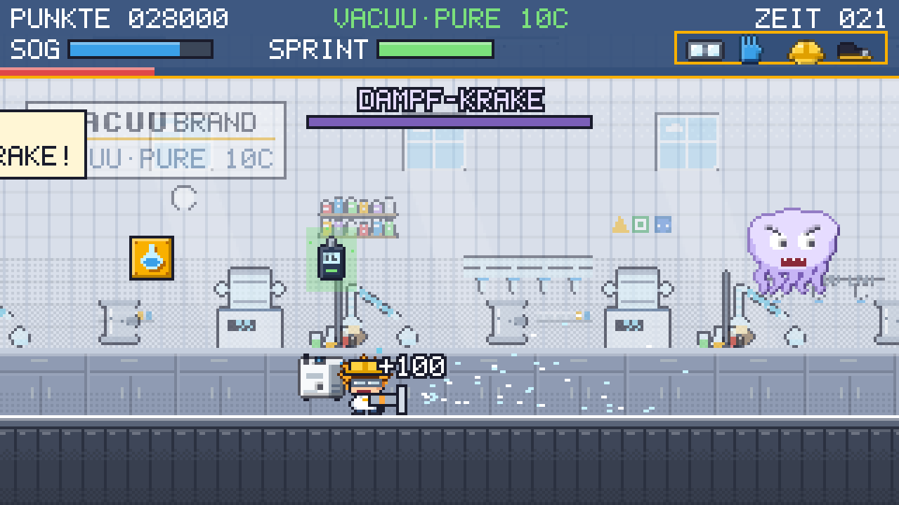 🐙 Endgegner <b>Dampf-Krake</b></td>
</tr>
</table>

Die Plattformen im Spiel sind **VACUU·LAN** Leitungen, und die **VACUU·VIEW extended** gibt als „Zeitvakuum“ 10 Sekunden extra. So tauchen weitere Produkte ganz nebenbei auf.

---

## 🌍 Drei Sprachen, vier Länder

Das Spiel läuft auf **Deutsch, Englisch und Französisch** (Wunsch des UK-Teams). Vor jeder Runde wählen die Besucher ihr Land und ihre Sprache. Das passt für internationale Messen:

- 🇨🇭 Schweiz (Deutsch, Französisch oder Englisch wählbar), 🇩🇪 Deutschland, 🇬🇧 UK/Irland, 🇫🇷 Frankreich
- Der QR-Code am Ende führt zu den Ansprechpartnern des gewählten Landes
- Das Titelbild ist für alle auf Englisch. Das Standpersonal stellt die Gerätesprache (Vorwahl in der Länderwahl) und die Sprache des Admin-Bereichs (Deutsch/Englisch) selbst ein
- Im Export stehen Land und Sprache jedes Spielers
- Ohne Länderwahl (Schnellstart) führt der QR-Code zu den Ansprechpartnern weltweit
- Die QR-Codes lassen sich auf einer eigenen Seite prüfen: [qr/index.html](https://gsb-deleven.github.io/vacuubrand-game/qr/)

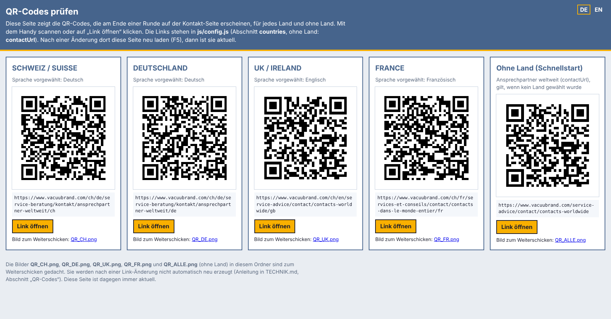

> [!NOTE]
> Die englischen und französischen Texte sind Entwürfe und werden noch vom Marketing geprüft (siehe [TEXTE.md](TEXTE.md)).

---

## ⭐ Was alles drin ist

🔋 **Stärkere Pumpen.** Jede neue Pumpe hat mehr Reichweite und mehr Saugkraft.

🦺 **Schutzausrüstung.** Schutzbrille, Handschuhe, Schutzhelm und Sicherheitsschuhe haben je einen Vorteil im Spiel. Wer alle vier hat, spielt mit „Vollschutz“. Das Thema Laborsicherheit kommt damit ganz nebenbei ins Spiel.

🔥 **Combo-Serien.** Wer schnell hintereinander einsaugt, bekommt bis zu achtfache Punkte. Ein grosser goldener Kasten zeigt die Serie und einen ablaufenden Timer.

🥇 **Sechs Medaillen** mit Bonuspunkten, zum Beispiel „Krake bezwungen“, „Vollschutz“ oder „Unverletzt“. Damit gibt es auch nach einer guten Runde noch etwas zu jagen.

⏱️ **Zeitleiste.** Die restliche Zeit läuft als farbiger Balken ab, von Grün über Gelb zu Rot.

🎵 **8-Bit-Musik und Sound.** Jedes Labor hat eine eigene Melodie, der Endgegner ein eigenes Thema. Wenn der Professor getroffen wird, ruft er „Autsch!“.

🎮 **Tastatur, Gamepad, Joystick und Touch.** Ein Xbox- oder USB-Controller wird automatisch erkannt. Das sieht am Stand hochwertiger aus und schont die Laptop-Tastatur. Auf dem Tablet erscheinen Bildschirm-Tasten.

🔬 **Echte Laborgegner.** Reagenzgläser, Eppis, Rundkolben, Wellplatten, Lösemitteldampf und Moleküle wie H₂O, O₂, N₂ oder Ethanol als Kugelmodelle.

---

## 🏆 Bestenliste, Leads und Datenschutz

**Bestenliste und Preise**

- **Tages-Bestenliste**, damit es jeden Tag einen Gewinner gibt
- **Gesamt-Bestenliste** über die ganze Messe für einen Hauptpreis
- Wer mehrmals spielt, zählt mit seinem besten Ergebnis
- Das Standpersonal sieht im Admin-Bereich die Top 3 von heute und von der ganzen Messe mit den vollen Kontaktdaten und kann die Gewinner direkt anrufen oder anschreiben

**Leads und Datenschutz** 🔒

- Alle Daten bleiben **nur auf dem Messe-Laptop**. Es wird nichts ins Internet geschickt.
- Export als **Excel-Datei (CSV)**: eine Liste mit allen Kontakten, eine mit allen gespielten Runden, jeweils mit Land und Sprache. Die Kontakte können danach direkt ins CRM oder an den Vertrieb.
- Die Einwilligung ist Pflicht, der Newsletter freiwillig und separat angekreuzt.
- Nach der Messe löscht ein Knopf alle Daten.
- Für Anlässe ohne Lead-Sammlung gibt es im Admin den Schalter **Nur Spitzname**: Die Leute geben nur einen Spitznamen ein, es werden keine Kontaktdaten erfasst. Solange er an ist, zeigt der Admin einen gelben Warnbalken.

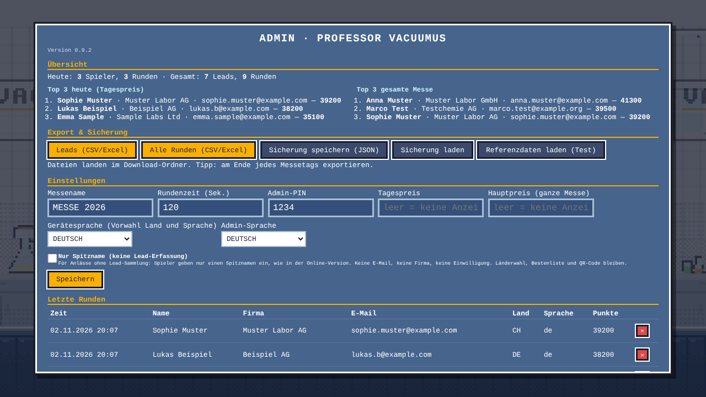

> [!IMPORTANT]
> Den Einwilligungstext sollte die Datenschutzstelle vor dem ersten Einsatz noch einmal anschauen, für UK/Irland und Frankreich jeweils separat. Er lässt sich in einer Datei ändern, ohne Programmierkenntnisse.

---

## ⬇️ Herunterladen

Die fertige Version zum Herunterladen: **[Professor Vacuumus, neueste Version](https://github.com/GSB-Deleven/vacuubrand-game/releases)**

1. Unten bei „Assets“ die Datei `Professor-Vacuumus-v….zip` laden.
2. Entpacken (Windows: Rechtsklick → „Alle extrahieren“, Mac: Doppelklick, Raspberry Pi: Rechtsklick → „Hier entpacken“).
3. Start-Datei doppelklicken: `▶ START Windows.bat`, `▶ START Mac.command` oder `▶ START Linux + Raspberry Pi.sh`.

Details und Hilfe, falls etwas nicht startet: [ANLEITUNG.md](ANLEITUNG.md#2-herunterladen-und-installieren).

---

## 💻 Was es braucht und wo es läuft

| | |
|---|---|
| 🖥️ Hardware | Ein normaler Firmen-Laptop **oder ein Tablet**. Mit einem grossen Bildschirm oder TV daneben wirkt es natürlich am besten. |
| 🎮 Optional | Ein USB-Gamepad oder Joystick |
| 📦 Installation | Keine. ZIP herunterladen und entpacken (oder Ordner kopieren), Doppelklick, läuft. |
| 🌐 Internet | Nicht nötig, das Spiel läuft komplett offline |
| 💰 Lizenzen | Keine. Das Spiel ist selbst entwickelt, ohne fremde Software oder Abos. |

| Gerät | So geht's |
|---|---|
| 💻 Windows-Laptop | `▶ START Windows.bat` doppelklicken |
| 🍎 Mac | `▶ START Mac.command` doppelklicken |
| 📱 iPad / iPhone | Online-Link öffnen, dann **Teilen → „Zum Home-Bildschirm“**: startet wie eine App im Vollbild, auch offline |
| 🤖 Android-Tablet / Handy | Online-Link öffnen, Menü → **„App installieren“** |
| 🍓 Raspberry Pi / Arcade-Automat | startet beim Einschalten direkt ins Spiel, Anleitung in [`raspberry-pi/README.md`](raspberry-pi/README.md) |
| 🕹️ Joystick, Gamepad, Arcade-Knöpfe | einstecken, fertig. Falls Knöpfe falsch liegen: im Admin **Controller einrichten** |

Auf Touch-Geräten erscheinen automatisch Bildschirm-Tasten: links ◀ ▶ zum Laufen, rechts SPRUNG und SAUGEN.

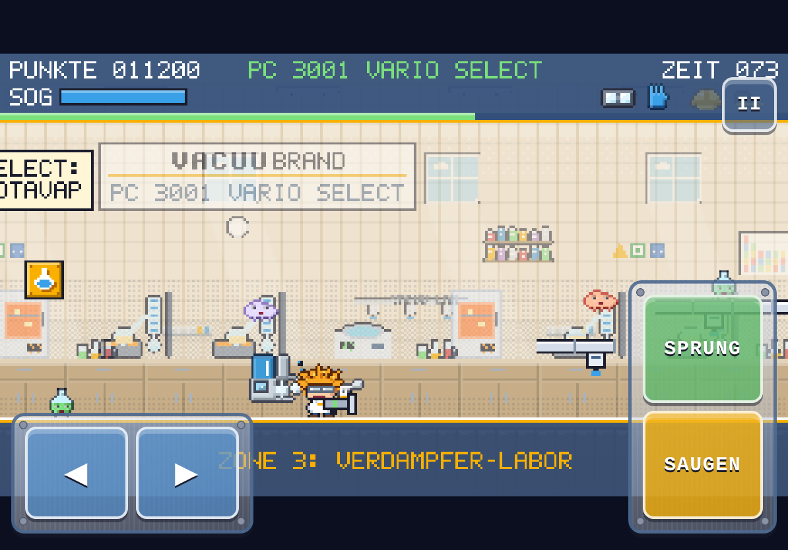

| Version | Adresse | Wofür |
|---|---|---|
| 🎪 **Messe (Laptop)** | Doppelklick auf die Start-Datei | Stand mit Anmeldung, Bestenliste und Kontakt-Export |
| 📱 **Messe (Tablet)** | [gsb-deleven.github.io/vacuubrand-game/?messe](https://gsb-deleven.github.io/vacuubrand-game/?messe) | wie oben, aber auf dem Tablet. Einmal öffnen, „Zum Home-Bildschirm“, danach läuft es auch ohne WLAN |
| 🧪 **Online-Test** | [gsb-deleven.github.io/vacuubrand-game](https://gsb-deleven.github.io/vacuubrand-game/) | **nur zum Testen**: nur ein Spitzname, keine Kontaktdaten, keine Datenübertragung |

---

## ⚙️ Anpassbar für jede Messe

- Messename auf dem Startbildschirm (z. B. „ILMAC 2026“)
- Rundenzeit
- Admin-PIN
- Tagespreis und Hauptpreis
- Texte der Anmeldung und der Einwilligung, in drei Sprachen
- Gerätesprache, Sprache des Admin-Bereichs und die Links der QR-Codes pro Land
- Pumpen-Slogans, Punkte und Zeitbonus

Für Anlässe ohne Lead-Sammlung gibt es im Admin den Schalter **Nur Spitzname**: Dann geben die Leute nur einen Spitznamen ein, wie in der Online-Version.

Messename, Rundenzeit, PIN, Preise, Sprachen und „Nur Spitzname“ gehen direkt im Admin-Bereich, der Rest in einer gut kommentierten Einstellungsdatei.

---

## ✅ Nächste Schritte bis zur Messe

1. 🔒 Einwilligungstext mit dem Datenschutz abstimmen
2. 🎁 Preise festlegen (Tagespreis und Hauptpreis)
3. 🖥️ Laptop, Bildschirm und eventuell ein Gamepad organisieren und einmal durchtesten
4. 🔑 Admin-PIN ändern und das Standpersonal kurz einweisen
5. ✏️ Spieltexte durch das Marketing prüfen lassen: alle Texte mit Vorschlägen stehen in [TEXTE.md](TEXTE.md)

---

## 📚 Weiterlesen und mitmachen

| | |
|---|---|
| 📖 [ANLEITUNG.md](ANLEITUNG.md) | Anleitung fürs Standpersonal: Starten, Steuerung, Ablauf, Admin-Bereich, Export, Tipps · 🇬🇧 [GUIDE.en.md](GUIDE.en.md) |
| 🛠️ [TECHNIK.md](TECHNIK.md) | Technisches Handbuch mit Aufbau, Dateien und allen Einstellungen |
| ✏️ [TEXTE.md](TEXTE.md) | alle Spieltexte auf Deutsch, Englisch und Französisch |
| 🍓 [raspberry-pi/README.md](raspberry-pi/README.md) | Raspberry Pi und Arcade-Automat |
| 💬 [Discussions](https://github.com/GSB-Deleven/vacuubrand-game/discussions) | lose Ideen, Fragen und Feedback nach der Messe |
| ✅ [Issues](https://github.com/GSB-Deleven/vacuubrand-game/issues) | konkrete Aufgaben, Fehler und Textänderungen, mit Vorlagen |
| 🗂️ [Project-Board](https://github.com/GSB-Deleven/vacuubrand-game/projects) und [Milestones](https://github.com/GSB-Deleven/vacuubrand-game/milestones) | Überblick, was bis zur Messe erledigt sein muss |
| 🤖 **@claude** | in einem Issue oder Kommentar erwähnen (oder Label „claude“ setzen): Claude setzt die Aufgabe um und schlägt einen Pull Request vor |
| 📖 [Wiki](https://github.com/GSB-Deleven/vacuubrand-game/wiki) | alle Anleitungen an einem Ort |

Alle Screenshots zeigen erfundene Beispieldaten.
